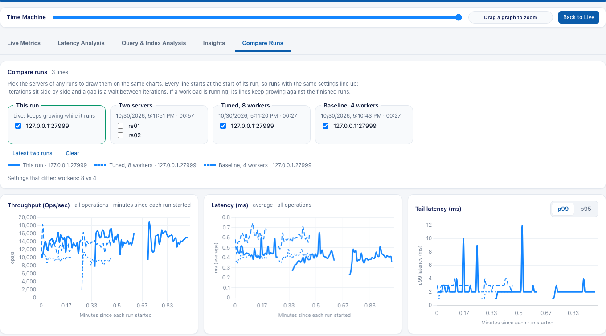
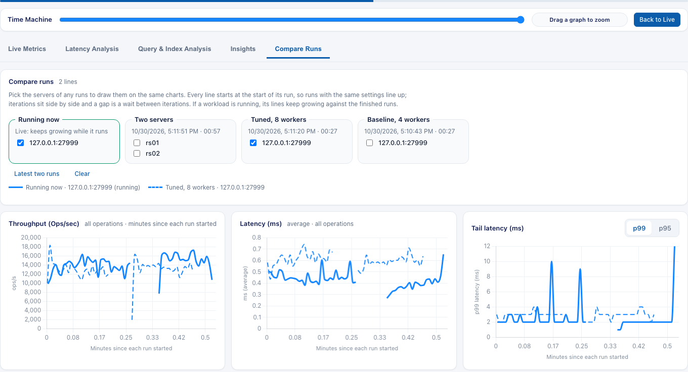

# Compare Runs

**Compare Runs** puts the charts of several runs, or of several servers, on top of each other, so you can see what changed between them: a new MongoDB version, a new index, a different server, or the same test two days later. A workload that is still running draws against the finished ones as it goes.

[Back to the main README](../README.md)

- [What it shows](#what-it-shows)
- [Open it](#open-it)
- [Pick what to compare](#pick-what-to-compare)
- [Read the charts](#read-the-charts)
- [Compare while a run is going](#compare-while-a-run-is-going)
- [Examples](#examples)
- [Make the comparison fair](#make-the-comparison-fair)
- [How long runs are kept, and labels](#how-long-runs-are-kept-and-labels)
- [Limits](#limits)
- [API](#api)

---

## What it shows

The **Compare Runs** tab is on the dashboard, next to **Live Metrics**, **Latency Analysis**, **Query & Index Analysis**, and **Insights**. It has three charts:

| Chart | What it draws |
| :--- | :--- |
| **Throughput (Ops/sec)** | Operations per second, all operations combined |
| **Latency (ms)** | Average latency, all operations combined |
| **Tail latency (ms)** | p99 or p95 latency. Switch with the **p99 / p95** buttons |

Each line is one **server of one run**:

- A run on one server has one line.
- A run on several servers (**Run on: Several servers**) has one line per server.

So you can compare one server across two days, two servers tested one after the other in separate runs, or the servers of a multi-server run with an earlier multi-server run.

## Open it

Any of these:

- Run a workload, or open any completed run, and click the **Compare Runs** tab.
- Click **Completed Runs** in the header, then **Compare** on a run (see the list below). The run's dashboard opens on **Compare Runs** with that run selected, plus the newest other run.
- While a workload runs, click **Compare Runs**. The running workload is already selected.

Runs are kept on disk, so you can compare after PLGM restarts. See [how long runs are kept](#how-long-runs-are-kept-and-labels).

## Pick what to compare

The picker lists the running workload first, then the stored runs, newest first. Each run is a box with its name, start time, and duration. Its servers are checkboxes.

- The **latest two runs** are selected when you first open the tab.
- Tick or untick a server to add or remove its line. The charts update at once.
- **Latest two runs** selects the two newest runs again. **Clear** removes every line.
- You can draw up to **8 lines** at a time, to keep the charts readable. Unticking a line lets you tick another.

## Read the charts

- **Color is the server.** The same server has the same color in every run, so the same server on Monday and Wednesday are the same color.
- **Line style is the run.** The newest run is solid. Older runs are dashed, then dotted, so two runs of the same server are easy to tell apart. The legend under the picker shows each line with its style.
- **The x-axis is minutes since each run started**, with fractions of a minute for short runs (0.5 is 30 seconds). Every line starts at 0, whatever time of day it ran, so runs of the same length line up.
- **Iterations sit side by side**, as on the other tabs. A **gap** in a line is a wait between iterations: nothing ran, so there is no value, not a line along zero.
- Point at a chart to see the values of the lines near that moment.
- **Settings that differ** appears under the legend when two or more stored runs are drawn, for example `workers: 8 vs 4 · duration: 30s vs 60s`. If it says the runs used the same settings, any difference in the lines comes from the servers or the environment.

## Compare while a run is going

When a workload is running, it is a **heavier line** labeled **Running now**. It grows as new samples arrive, against the finished runs, which stay fixed. The chart's x-axis grows to the longest line.

When the run finishes, the line stays and is now a normal completed run. It is not listed twice. Start another run, and the previous one is in the list with its selection kept.

## Examples

### Same test, two days apart

You ran a test on Monday and want to know if Wednesday's looks the same.

1. On Monday, run your workload as usual. It is stored when it finishes.
2. On Wednesday, run it again with the same settings.
3. Open **Compare Runs** while Wednesday's run is going. Wednesday is **Running now** (thick line) and Monday's run is selected next to it, so you watch the new run follow or drift from the old one.
4. When it finishes, look at the **Tail latency** chart. The dashed Monday line and the solid Wednesday line are the same color if they ran on the same server.

If the lines differ, check **Settings that differ** first. If it says the settings were the same, the change is in the server or the load around it.

### Server A against server B, in separate runs

You want to compare two MongoDB versions, and the servers can't be tested at the same time.

1. Run your workload on server A. Give it a label first (**Advanced > Trends & history > Run label**, for example `mongo-7.0`).
2. Run the same workload on server B (`mongo-8.0`). Use **Deterministic traffic** with the same **Random Seed** on both, so both servers get the same operations. See [Record and Replay](./record-and-replay.md#deterministic-generated-traffic).
3. Open **Compare Runs**. The two runs are selected. The lines have different colors (different servers) and different styles (different runs).
4. Read **Throughput** for the rate and **Tail latency** for the slow operations.

### A multi-server run against an earlier one

You run your workload on three servers in one run, then repeat it after an upgrade.

1. Run the workload with **Run on: Several servers**, listing `rs01`, `rs02`, and `rs03`.
2. After the upgrade, run it again the same way.
3. In **Compare Runs**, each run is a box with three servers. Tick all six, or only `rs02` from both runs to see just that server before and after.

Six lines are within the 8-line limit. For more than that, tick a few servers at a time.

### Compare one run from the list

1. Click **Completed Runs** in the header.
2. Click **Compare** on the run you care about.
3. The run opens on **Compare Runs** with the newest other run next to it. Tick other runs or servers to change the comparison.

## Make the comparison fair

Two runs only compare well if they did the same work.

- Use the same **Duration**, **Concurrency**, **Documents**, and workload mix. **Settings that differ** shows what changed.
- For generated traffic, turn on **Deterministic traffic** and use the same **Random Seed** and **Operations per Worker** on every run. Then both runs send the same operations.
- Run on similar hardware, and with similar background load.
- Save the settings. **Save & Load Run Settings** keeps a file per run, so you can reload them for the next run. See [Web UI](./web-ui.md#save-and-load-run-settings).

## How long runs are kept, and labels

Compare Runs uses the same stored runs as **Completed Runs**. These settings control how long they last. Change them in **Advanced > Trends & history**, in `config.yaml`, or with the environment variables.

| Setting | Default | What it does |
| :--- | :--- | :--- |
| **Runs to keep** (`trend_history_runs`, `PLGM_TREND_HISTORY_RUNS`) | 5 (1 to 50) | How many unpinned runs are kept. The oldest are removed first. |
| **Outdated after (days)** (`trend_max_age_days`, `PLGM_TREND_MAX_AGE_DAYS`) | 30 (0 = never) | Older unpinned runs are marked outdated but are kept and can still be compared. |
| **Run label** (`trend_run_label`, `PLGM_TREND_RUN_LABEL`) | `Generic workload <date>` and the like | The name shown in the picker and the legend. Up to 64 bytes. |

**Pin** a run on **Completed Runs** to keep it past the limit, for example a baseline you compare with every time. Plan for the 5-run default: if you compare across many runs, raise **Runs to keep** or pin the ones you need. See [Trends and History](./trends-and-history.md#history-labels-and-pinning).

The label is optional. A short label such as `mongo-8.0-with-new-index` makes the picker and the legend easier to read than a date.

## Limits

- At most **8 lines** at a time.
- Runs stored before version 7.0.0 have no server names. They are listed with one server, called `server`, and their stored charts still draw.
- The settings of the running workload are not compared with the stored runs until it is stored.
- **Compare Runs** draws throughput and latency. For per-query comparison (query shapes, scan efficiency), use **Query & Index Analysis > Trends**; see [Trends and History](./trends-and-history.md#compare-runs-in-the-web-ui).
- It shows all operations combined. The **Operation** choice on the other tabs does not apply here.

## API

- `GET /api/run-history` lists stored runs. Each has `servers`, the server names: the targets of a multi-server run, or the connection host (host and port, no user or password).
- `GET /api/run-history/{id}` returns one stored run with its `stats.chartHistory`, or `stats.targets[].chartHistory` for a multi-server run.
- `GET /api/stats` includes `dashboardId`, the ID the running workload is stored under when it finishes.
