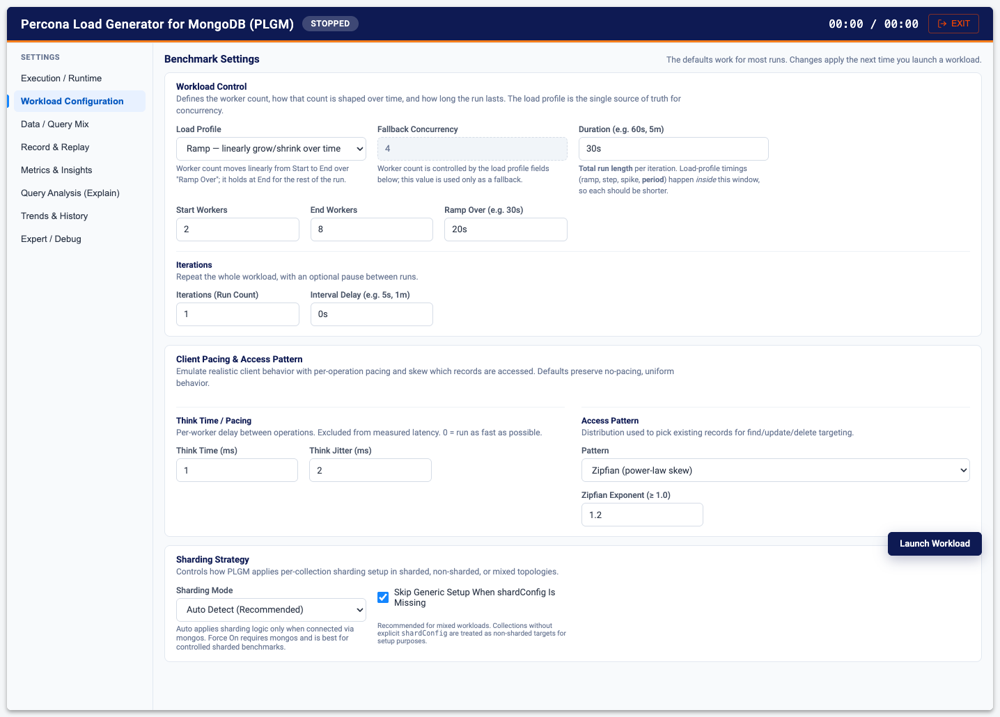

# Load Modeling

Real applications don't run at a fixed number of threads hitting random documents. PLGM can shape load over time, pace clients, skew access toward hot documents, show tail-latency drift over the run, and build a starting workload from your query logs.

[Back to the main README](../README.md)

- [Load Profiles (load shaping)](#load-profiles-load-shaping)
- [Think Time / Pacing](#think-time--pacing)
- [Access-Pattern Skew](#access-pattern-skew)
- [Latency Heatmap Over Time](#latency-heatmap-over-time)
- [Schema Inference from Query Logs](#schema-inference-from-query-logs)

---

## Load Profiles (load shaping)

Instead of a constant worker count, you can ramp, step, spike, or oscillate
concurrency over the run. The worker pool is sized to the profile's peak, and a
controller gates how many workers are active at any moment. The live target and
active worker counts are exposed in `/api/stats` (`concurrencyTarget`,
`concurrencyActive`).

**In the Web UI:**

1. Open **Workload Configuration > Workload Control**.
2. Set **Duration (e.g. 60s, 5m)** for the whole run.
3. Pick a **Load Profile**. The fields for that profile appear:
   - **Fixed**: **Concurrency (Active Workers)**.
   - **Ramp**: **Start Workers**, **End Workers**, **Ramp Over (e.g. 30s)**.
   - **Step**: **Steps**, a JSON array such as `[{"workers": 5, "duration": "30s"}, {"workers": 20, "duration": "60s"}]`.
   - **Spike**: **Base Workers**, **Peak Workers**, **Spike At (e.g. 20s)**, **Spike For (e.g. 5s)**.
   - **Sine**: **Min Workers**, **Max Workers**, **Period (e.g. 30s)**.
4. Click **Launch Workload**. The dashboard shows the target and active worker counts as the profile runs.

The same tab also holds [Think Time / Pacing](#think-time--pacing) and the [Access Pattern](#access-pattern-skew). Here a ramp from 2 to 8 workers over 20 seconds is combined with 1 ms think time plus up to 2 ms jitter and Zipfian access:



**In `config.yaml`:**

```yaml
# config.yaml
concurrency: 16            # used as the fixed/fallback worker count
load_profile:
  kind: ramp               # fixed | ramp | step | spike | sine
  start_workers: 1
  end_workers: 50
  ramp_over: 30s
# step example:
#   kind: step
#   steps: [{workers: 5, duration: 30s}, {workers: 20, duration: 60s}]
# spike example:
#   kind: spike
#   base_workers: 5
#   peak_workers: 50
#   spike_at: 20s
#   spike_for: 5s
# sine example:
#   kind: sine
#   min_workers: 5
#   max_workers: 50
#   period: 30s
```

Invalid profiles (bad durations, negative workers, malformed steps) are rejected
with a clear error before the run starts. An empty/`fixed` profile preserves the
historical fixed-concurrency behavior. Load profiles that change concurrency cannot be used with [deterministic traffic](./record-and-replay.md#deterministic-generated-traffic), and a replay ignores them.

Env overrides: `PLGM_LOAD_PROFILE_KIND`, `PLGM_LOAD_PROFILE_WORKERS`.

### `duration` vs. load-profile timings (`period`, `ramp_over`, `spike_at`, ...)

These are two different kinds of setting and are easy to confuse:

- **`duration`** is the **total run length** of the benchmark (per iteration):
  the whole window the workload executes for (e.g. `120s`, `5m`).
- **Load-profile timings** describe **what happens *inside* that window**. They
  are always *sub-intervals* of `duration`, so each should be shorter than it:
  - `ramp_over`: how long the ramp from Start to End workers takes.
  - `steps[].duration`: how long each step holds its worker count.
  - `spike_at` / `spike_for`: when the spike starts and how long it lasts.
  - **`period`** (Sine only): the length of **one full oscillation**
    (Min → Max → Min). It is *not* the run length.

**How `period` relates to `duration` (Sine):** the run completes
`duration ÷ period` oscillations. Keep `period ≤ duration`, and for whole,
symmetric waves make `duration` an integer multiple of `period`.

| `duration` | `period` | Result |
| :--- | :--- | :--- |
| `120s` | `30s` | 4 complete oscillations |
| `60s` | `60s` | Exactly 1 oscillation |
| `60s` | `120s` | Only half an oscillation (Min → Max, run ends before returning) |

The same principle applies to the other profiles: e.g. a `ramp_over: 30s` inside
a `duration: 120s` ramps for the first 30s, then holds at End workers for the
remaining 90s.

## Think Time / Pacing

Add a per-worker delay between operations to emulate realistic clients or hold a
steady, sub-saturation request rate. Pacing time is excluded from measured
operation latency.

**In the Web UI:** open **Workload Configuration > Client Pacing & Access Pattern > Think Time / Pacing** and set **Think Time (ms)** and, optionally, **Think Jitter (ms)**.

```yaml
think_time_ms: 0     # fixed delay between operations
think_jitter_ms: 0   # extra uniform random 0..jitter ms per delay
```

Env overrides: `PLGM_THINK_TIME_MS`, `PLGM_THINK_JITTER_MS`.

## Access-Pattern Skew

Control which existing records are selected for find/update/delete targeting.
Skewed access exposes cache pressure and lock/hot-shard contention that uniform
access hides.

**In the Web UI:** open **Workload Configuration > Client Pacing & Access Pattern > Access Pattern** and choose a **Pattern**:

- **Uniform**: every record equally likely.
- **Zipfian**: power-law skew. Set **Zipfian Exponent (≥ 1.0)**; higher means more skew.
- **Hotspot**: a small subset gets most traffic. Set **Hot Records (%)** and **Hot Traffic (%)**, for example 20% of records receiving 80% of traffic.

```yaml
access_pattern:
  kind: uniform          # uniform | zipfian | hotspot
  # zipfian:
  #   kind: zipfian
  #   zipfian_exponent: 1.5   # >= 1.0; higher = more skew
  # hotspot:
  #   kind: hotspot
  #   hotspot_percent: 20        # share of records that are "hot"
  #   hotspot_traffic_percent: 80 # share of traffic to the hot set
```

Env overrides: `PLGM_ACCESS_PATTERN_KIND`, `PLGM_ACCESS_PATTERN_ZIPFIAN_EXPONENT`,
`PLGM_ACCESS_PATTERN_HOTSPOT_PERCENT`, `PLGM_ACCESS_PATTERN_HOTSPOT_TRAFFIC_PERCENT`.

## Latency Heatmap Over Time

PLGM buckets latency into ~1&nbsp;second time windows and records p50/p95/p99/max
per window (across **all operation types combined**), so you can see
tail-latency drift over the run. The series is exposed in `/api/stats`
(`latencyHeatmap`) and rendered as an inline chart both in the live **Latency
Analysis** tab and in the exported report. There is nothing to configure: open the **Latency Analysis** tab on the dashboard while the workload runs.


Each column in the heatmap is one time window. Two independent visual channels
encode the data:

- **Color = absolute p99 latency.** Colors map to fixed latency thresholds
  (based on common database/APM norms), *not* to the run's own maximum. This
  means a fast run stays green even if one window is relatively taller than the
  others; the heatmap will never paint a healthy 10&nbsp;ms run red just
  because it is the busiest window seen so far.

  | p99 (this window) | Color | Interpretation |
  | :--- | :--- | :--- |
  | &le; 10 ms | Green | Excellent |
  | ~25 ms | Lime | Very good |
  | ~50 ms | Yellow | Good |
  | ~100 ms | Orange | Moderate |
  | ~250 ms | Red | Slow |
  | ~500 ms | Strong red | Very slow |
  | &ge; 1 s | Dark red | Critical |

  Values between anchors are interpolated, so the color transitions smoothly.

- **Bar height = relative drift.** Height is scaled to this run's own peak p99,
  so you can always see *when* tail latency rose or fell during the run, even in
  an all-green run where every window is objectively fast.

Hover any column to see the full per-window breakdown (ops in window,
throughput, and p50/p95/p99/max). While the cursor is over the heatmap it
pauses updating so you can inspect a window; it resumes and catches up to the
latest data as soon as the cursor leaves.

> Note: because each window is short, an occasional slow operation (for example
> a heavy aggregation) can lift a single window's p99 above the cumulative p99
> shown in the distribution table. That is expected: surfacing exactly *when*
> tail latency occurred is the purpose of this view.

## Schema Inference from Query Logs

Paste mongod JSON slow-query logs, `system.profile` documents, or raw command
documents and PLGM infers the collections touched, per-operation
filter/sort/update/projection fields, candidate queries, and a suggested
operation mix (find/insert/update/delete/aggregate percentages) that can pre-fill
the distribution fields. Malformed or unrecognized lines are skipped and reported
rather than failing the whole inference.

**In the Web UI:**

1. Open **Data / Query Mix > Schema Inference from Query Logs**.
2. Paste the log lines or documents into the text box.
3. Click **Infer Schema** and review the suggested collections, queries, and mix.
4. Click **Apply Suggested Mix** to fill the **Operation Mix Allocation** fields.

From the API: `POST /api/infer-schema` with `{"log": "..."}`.

Schema inference gives you a starting workload. To replay the captured operations themselves, use [Import Captured Traffic](./record-and-replay.md#import-captured-traffic).
