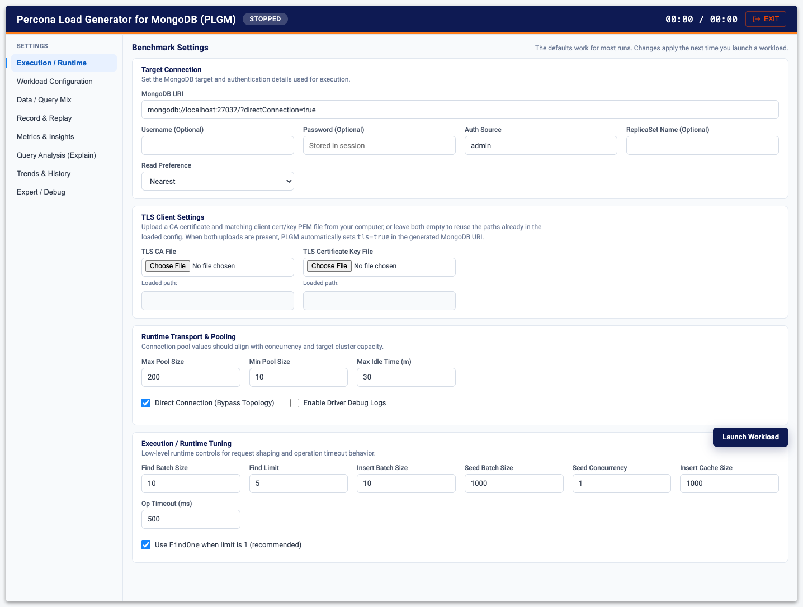

# Performance Tuning and Connection Settings

PLGM uses all available system resources by default, but you can tune it to fit specific hardware limits or test scenarios. This page also covers connection parameters and TLS.

[Back to the main README](../README.md)

- [CPU Utilization (`GOMAXPROCS`)](#cpu-utilization-gomaxprocs)
- [Concurrency & Workers](#concurrency--workers)
- [Connection Pooling](#connection-pooling)
- [Operation Optimization](#operation-optimization)
- [Timeouts & Reliability](#timeouts--reliability)
- [Workload Iterations & Scheduling](#workload-iterations--scheduling)
- [Custom Connection Parameters (`custom_params`)](#custom-connection-parameters-custom_params)
- [Connecting to TLS/SSL-Enabled Clusters](#connecting-to-tlsssl-enabled-clusters)

For the operation mix (find/insert/update/delete percentages), see [Workloads](./workloads.md#operation-mix-and-transactions).

---

## CPU Utilization (`GOMAXPROCS`)

By default, PLGM detects and schedules work across **all available logical CPUs**. You generally do not need to configure this.

If you are running in a constrained environment (e.g., a shared CI runner or a container with strict CPU limits), or you want to throttle the generator's CPU usage, override it with the standard Go environment variable:

```bash
# Limit plgm to use only 2 CPU cores
export GOMAXPROCS=2
./plgm
```

## Concurrency & Workers

**Web UI:** **Workload Configuration > Workload Control > Concurrency (Active Workers)**. To vary the worker count during the run, see [Load Profiles](./load-modeling.md#load-profiles-load-shaping).

* **`concurrency`**: Controls the number of "Active Workers" continuously executing operations against the database.
    * *Tip:* Increase this to generate higher load. If set too high on a weak client, you may see increased client-side latency.
    * *Default:* `4`

## Connection Pooling

**Web UI:** **Execution / Runtime > Runtime Transport & Pooling**: **Max Pool Size**, **Min Pool Size**, **Max Idle Time (m)**, and **Direct Connection (Bypass Topology)**.



These settings control the MongoDB driver's connection pool. Proper sizing prevents workers from waiting for available connections.

* **`max_pool_size`**: The maximum number of connections allowed in the pool.
    * *Tip:* Set this slightly higher than your `concurrency` setting so that every worker is guaranteed a connection without blocking.
    * *Default:* `1000`
* **`min_pool_size`**: The minimum number of connections to keep open.
    * *Tip:* Setting this higher helps avoid the "cold start" penalty of establishing new connections during the initial ramp-up.
    * *Default:* `20`
* **`max_idle_time`**: How long a connection can remain unused before being closed (in minutes).
    * *Tip:* Keep this high (e.g., `30`) to avoid reconnect churn during brief pauses in the workload.
* **`direct_connection`**: Force a direct connection and bypass topology discovery.

## Operation Optimization

**Web UI:** **Execution / Runtime > Execution / Runtime Tuning**: **Find Batch Size**, **Find Limit**, **Insert Batch Size**, **Seed Batch Size**, **Seed Concurrency**, **Insert Cache Size**, **Op Timeout (ms)**, and **Use `FindOne` when limit is 1** (recommended).

These settings affect the efficiency of individual database operations and memory usage.

* **`find_batch_size`**: The number of documents returned per batch in a cursor.
    * *Tip:* Higher values reduce network round-trips but increase memory usage per worker.
    * *Default:* `10`
* **`insert_batch_size`**: The number of documents inserted by bulk inserts.
    * *Default:* `10`
* **`seed_batch_size`**: The number of documents grouped into a single InsertMany call during the initial data seeding phase.
    * *Tip:* Keeps memory usage stable when seeding millions of documents. A value of 1000 is recommended for performance.
    * *Default:* `1000`
* **`seed_concurrency`**: Maximum concurrent InsertMany calls during initial seeding. Independent of workload `concurrency`. See [Parallel Initial Seeding](./workloads.md#parallel-initial-seeding).
    * *Default:* `1`
* **`find_limit`**: The hard limit on documents returned for `find` operations.
    * *Default:* `5`
* **`insert_cache_size`**: The buffer size for the document generator channel.
    * *Tip:* This decouples document generation from database insertion. A larger buffer ensures workers rarely wait for data generation logic.
    * *Default:* `1000`

## Timeouts & Reliability

**Web UI:** **Op Timeout (ms)** is on **Execution / Runtime > Execution / Runtime Tuning**. Retries are on **Expert / Debug**: open **Show Expert Retry Controls** and set **Retry Attempts** and **Retry Backoff (ms)**.

Control how PLGM reacts to network lag or database pressure.

* **`op_timeout_ms`**: A hard timeout for individual database operations.
    * *Tip:* Lowering this allows PLGM to fail fast and retry rather than hanging on stalled requests.
    * *Default:* `500` (0.5 seconds)
* **`retry_attempts`** & **`retry_backoff_ms`**: Logic for handling transient failures.
    * *Tip:* For stress testing, you might want to set `retry_attempts: 0` to see raw failure rates immediately.
    * *Default:* `2` attempts with `5ms` backoff.

## Workload Iterations & Scheduling

**Web UI:** **Workload Configuration > Iterations**: **Iterations (Run Count)** and **Interval Delay (e.g. 5s, 1m)**.

Control how PLGM repeats a given workload and schedules the time between runs.

* **`iterations`**: The number of times to run the defined workload duration back-to-back.
    * *Tip:* Use the first iteration to warm up the database cache and capture true performance metrics on subsequent iterations, without restarting the tool.
    * *Default:* `1`
* **`interval_delay`**: The amount of time to pause the workload between each iteration (e.g., `10s`, `1m`).
    * *Tip:* Adding a delay allows database background processes (like log flushing, checkpointing, or compaction) to catch up, simulating real-world batch-processing patterns.
    * *Default:* `0s`
    * The header clock total is every iteration's Duration plus a pause after each iteration except the last. Five runs of 30s with a 10s delay is 03:10, not 02:30: 5 × 30s of workload and 4 × 10s of pauses. Once execution starts, the clock shows a short note with that breakdown. The note stays hidden during initialization. There is no pause after the final iteration.

The **Insights > Iterations** view on the dashboard overlays the iterations so you can compare them.

## Custom Connection Parameters (`custom_params`)

In `config.yaml`, the `custom_params` section passes arbitrary options directly to the MongoDB driver's connection string. These parameters are appended as URI query options and matter for network throughput, security, and routing. All standard MongoDB connection parameters are supported. In the Web UI, add them to the **MongoDB URI** as query options instead.

```yaml
custom_params:
  compressors: "zlib,snappy"
```

| Parameter | Example Value | Impact on Performance |
| :--- | :--- | :--- |
| **`compressors`** | `"snappy,zlib"` | **High Impact.** Enables network compression. <br>• **`snappy`**: Low CPU overhead, moderate compression. Good for high-throughput, low-latency. <br>• **`zlib`**: Higher CPU overhead, high compression. Good for limited bandwidth. <br>• **Empty**: No compression (saves CPU, uses max bandwidth). |
| **`readPreference`**| `"secondary"` | **Medium Impact.** (Optional) Can be added to offload read operations to replica set secondaries, keeping the primary free for writes. |

***Note: From the perspective of the MongoDB Go driver, tls and ssl are synonymous. They do the exact same thing. Historically, MongoDB used the term ssl, but has moved to tls to reflect current security standards. The driver supports both for backwards compatibility.***

## Connecting to TLS/SSL-Enabled Clusters

If your target MongoDB cluster enforces TLS/SSL, configure the TLS client files.

**Web UI:**

1. Open **Execution / Runtime > TLS Client Settings**.
2. Use the file pickers to choose the **TLS CA File** and the **TLS Certificate Key File** (combined certificate and key PEM).
3. Click **Launch Workload**. The files are saved to temporary paths and used for the connection.

**`config.yaml`:**

```yaml
connection_params:
  tls_ca_file: "/etc/ssl/ca.crt"
  tlsCertificateKeyFile: "/etc/ssl/tls.pem" # Combined certificate/key PEM file
```

PLGM sets `tls=true` in the generated MongoDB URI when both TLS client files are present, and `tls=false` when they are not. Do not duplicate `tls`, `tlsCAFile`, or `tlsCertificateKeyFile` under `custom_params`.

Further configuration and examples for [Kubernetes environments with TLS are here](../k8s_and_docker.md#3-running-plgm-with-tls-on-kubernetes).

For TLS on the Web UI itself (HTTPS), see [The Web UI](./web-ui.md#http-vs-https-no-certificate-warnings).
