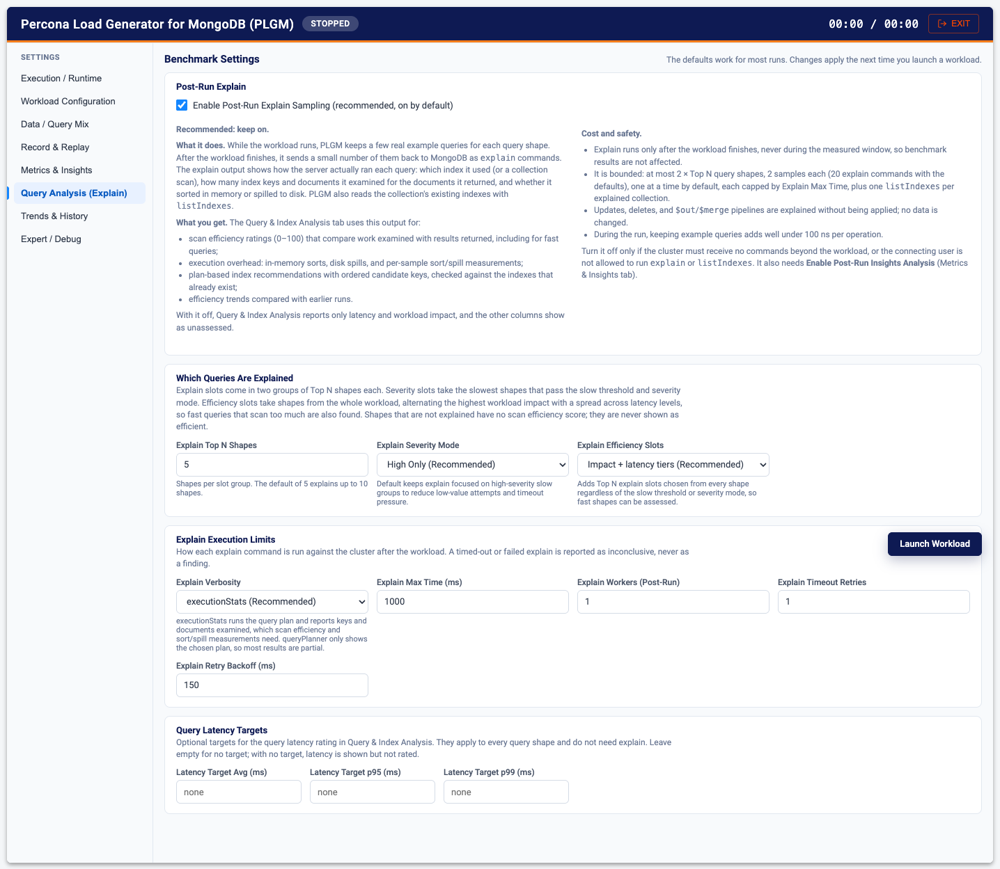
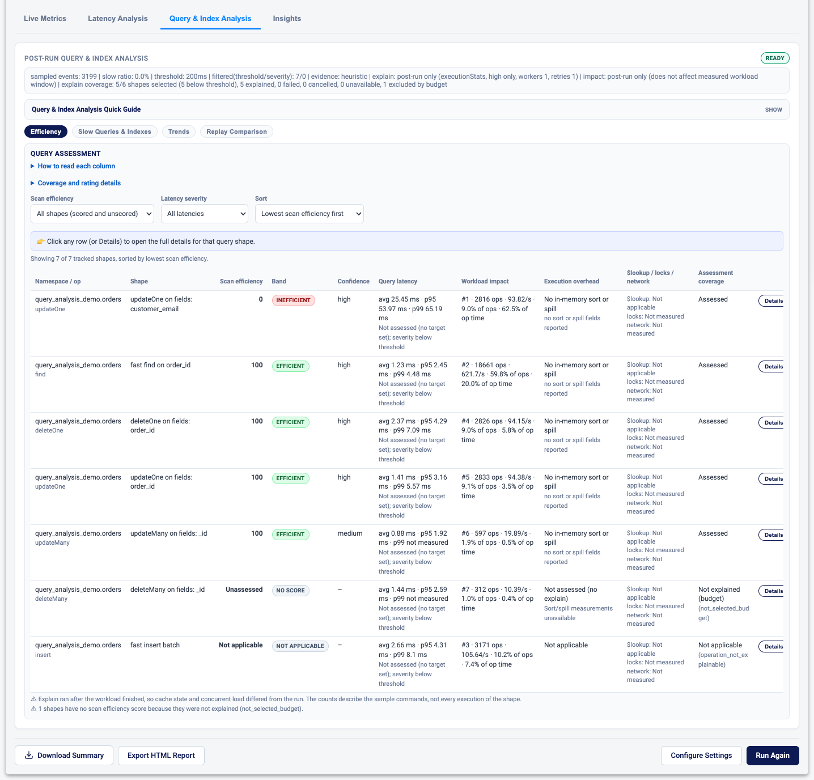
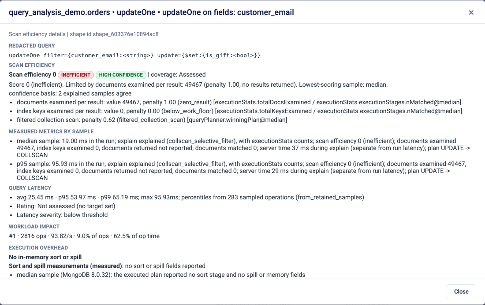
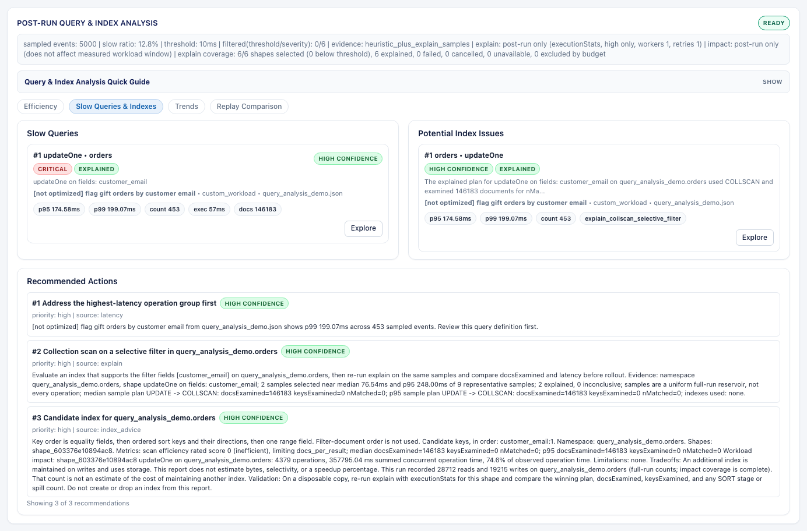
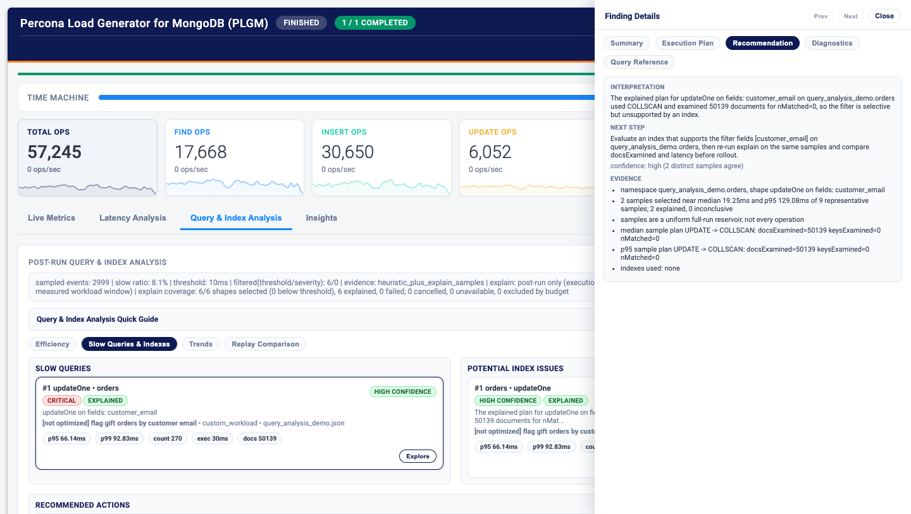
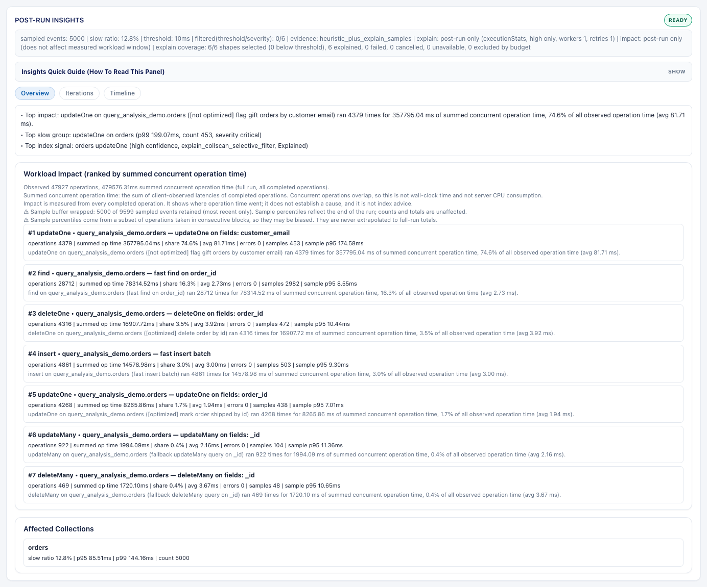

# Query and Index Analysis

Latency tells you that a query is slow. It doesn't tell you why, and it says nothing about the query that is fast today only because the collection is still small. After the workload finishes, PLGM runs explain on samples of every query shape it executed (fast ones included) and shows what the server actually did: how much it scanned, whether it sorted in memory or spilled to disk, and which index would help.

This page covers setup and the views. The full reference (explain support matrix, status and reason glossary, confidence model, troubleshooting, and limitations) is in [`INSIGHTS.md`](../INSIGHTS.md).

[Back to the main README](../README.md)

- [Set up the analysis in the Web UI](#set-up-the-analysis-in-the-web-ui)
- [Read the results](#read-the-results)
- [Try it with the demo workload](#try-it-with-the-demo-workload)
- [Settings reference](#settings-reference)
- [What it does not do](#what-it-does-not-do)

---

## Set up the analysis in the Web UI

> **Post-Run Explain Sampling is required for the full query analysis.** Scan efficiency, execution overhead (sorts and disk spills), plan-based index recommendations, and efficiency trends are built from explain output collected after the workload finishes. The setting (`insights_explain_enabled`, Web UI: **Query analysis** category, Advanced) is on by default. With it off, the analysis reports only latency and workload impact, and the dashboard and HTML report state that explain was turned off. Explain does not run during the measured workload, so benchmark results are unaffected.

1. Start the UI with `./plgm --webui`, choose a task, and turn on **Advanced** (and **Expert** for the explain limits and latency targets).
2. **Metrics & reporting > Insights Capture (Sampling & Retention)**:
   - **Enable Post-Run Insights Analysis**: on.
   - **Insights Sampling Rate (0-1)**: share of operations captured for analysis (default `0.10`).
   - **Slow Threshold (ms)**: operations above this are classified as slow (default `200`).
   - **Max Retained Events** and **Max Group Entries**: memory limits for captured events and shape groups.
3. **Query analysis**:
   - **Enable Post-Run Explain Sampling**: keep it on (the default).
   - **Which Queries Are Explained** (Expert): **Explain Top N Shapes**, **Explain Severity Mode** (High Only is recommended), and **Explain Efficiency Slots** (Impact + latency tiers is recommended; it also explains fast shapes with high workload impact).
   - **Explain Execution Limits** (Expert): **Explain Verbosity** (`executionStats` is recommended; `queryPlanner` is lighter), **Explain Max Time (ms)**, **Explain Workers (Post-Run)**, **Explain Timeout Retries**, and **Explain Retry Backoff (ms)**.
   - **Query Latency Targets** (Expert): optional **Latency Target Avg / p95 / p99 (ms)**. Each shape is then marked as within or above target. Leave them at `0` and no rating is made up.
4. Optional: configure run history in **Trends & history**. See [Trends and History](./trends-and-history.md).
5. Click **Launch Workload**.

## Read the results

When the run completes, open the **Query & Index Analysis** tab on the dashboard. It has four views:

- **Efficiency**: one row per query shape, with separate columns. Measurements are never blended into one score.
  - **Scan efficiency (0 to 100, higher is better)**: documents and index keys examined per result returned, and collection scans where there shouldn't be one. One document examined per result scores 100; 1,000 or more scores 0. Latency is not part of this score, small amounts of work are not flagged, a full scan you asked for is not a problem, and `$group` pipelines are judged on the documents going into the group. This is a PLGM rule of thumb, not an official MongoDB metric.
  - **Latency**: average and max for every shape, plus p95 and p99 when there are enough samples, rated against your targets if you set them.
  - **Workload impact**: operations, operations per second, and share of total operation time. A 2 ms query run 10,000 times a second can matter more than a 300 ms report run twice.
  - **Execution overhead**: in-memory sorts and disk spills, with sort bytes, spill counts, spilled size, memory limit, and peak memory per sample.
  - **$lookup work**: documents and keys examined in the joined collection, when explain reports them.
- **Slow Queries & Indexes**: slow-query groups and index recommendations. Suggested keys follow equality, then sort, then range, and are checked against the indexes that already exist. Each recommendation lists the shapes it helps, the reasoning and confidence, the write and storage cost, and how to validate it. Test on a non-production system first.
- **Trends**: comparison with earlier runs. See [Trends and History](./trends-and-history.md).
- **Replay Comparison**: operation-by-operation comparison of two replays. See [Record and Replay](./record-and-replay.md#compare-replays).

The screenshots below come from the [demo workload](#try-it-with-the-demo-workload). In the **Efficiency** view, the unindexed `updateOne` on `customer_email` scores 0 (inefficient) while the shapes backed by an index score 100:

Click any row (or **Details**) to open the shape's detail dialog. It shows the redacted query, how the scan efficiency score was reached, the measured metrics of each explained sample, latency, workload impact, and execution overhead:

In **Slow Queries & Indexes**, each slow query and index issue has an **Explore** button. It opens the **Finding Details** drawer with **Summary**, **Execution Plan**, **Recommendation**, **Diagnostics**, and **Query Reference** (which maps the finding back to your query definition). This run used a **Slow Threshold** of 10 ms so the demo's slow shape is listed:

The **Insights** tab adds **Overview**, **Iterations**, and **Timeline** views: workload impact ranking, affected collections, a per-iteration overlay, and a time-sliced drill-down.

The analysis is also included in the **Download Summary** JSON (`insights` section) and the **Export HTML Report**. See [Reports and Exports](./reports-and-exports.md).

The analysis covers reads and writes. Updates, deletes, and `$out`/`$merge` pipelines are explained without being applied. Mixed sharded and non-sharded runs are supported, with per-collection detection and explicit sharding strategy controls (**Workload execution > Sharding Strategy**, Expert).

## Try it with the demo workload

The repo ships a demo in [`resources/collections/query_analysis_demo.json`](../resources/collections/query_analysis_demo.json) and [`resources/queries/query_analysis_demo.json`](../resources/queries/query_analysis_demo.json): an orders collection with some queries backed by good indexes, some clearly not (a lookup by customer email with no index, a sort that doesn't match any index, an update that scans), and one report that is meant to read the whole collection.

1. Choose **Run a custom workload**. In **Data & Query Definitions**, import both files with **Save to Library** and select them in the **Saved Definition Library** dropdowns.
2. Set **Seed Document Count** to `100000`, and in **Workload Control** set **Duration** to `60s`.
3. Click **Launch Workload**, and open **Query & Index Analysis** when it finishes.

This walkthrough shows the full flow, from configuration to the post-run analysis:

https://github.com/user-attachments/assets/f133fd5a-baf8-4d6f-89e1-c179b83c4bef

## Settings reference

| Config Setting | Environment Variable | Description | Default |
| :--- | :--- | :--- | :--- |
| `insights_enabled` | `PLGM_INSIGHTS_ENABLED` | Enable post-run slow-query/index analysis | `true` |
| `insights_sampling_rate` | `PLGM_INSIGHTS_SAMPLING_RATE` | Sample rate for captured operation events (`0.01`-`1.0`) | `0.10` |
| `insights_slow_threshold_ms` | `PLGM_INSIGHTS_SLOW_THRESHOLD_MS` | Latency threshold used to classify operations as slow | `200` |
| `insights_max_events` | `PLGM_INSIGHTS_MAX_EVENTS` | Max retained sampled events in memory | `5000` |
| `insights_max_groups` | `PLGM_INSIGHTS_MAX_GROUPS` | Max aggregated slow-shape groups | `300` |
| `insights_explain_enabled` | `PLGM_INSIGHTS_EXPLAIN_ENABLED` | Enable post-run explain sampling (needed for scan efficiency and sort/spill measurements; runs after the workload) | `true` |
| `insights_explain_top_n` | `PLGM_INSIGHTS_EXPLAIN_TOP_N` | Number of top slow shapes to attempt explain on | `5` |
| `insights_explain_max_time_ms` | `PLGM_INSIGHTS_EXPLAIN_MAX_TIME_MS` | Max server time per explain command | `1000` |
| `insights_explain_verbosity` | `PLGM_INSIGHTS_EXPLAIN_VERBOSITY` | Explain verbosity (`executionStats` recommended, `queryPlanner` lighter) | `executionStats` |
| `insights_explain_severity_mode` | `PLGM_INSIGHTS_EXPLAIN_SEVERITY_MODE` | Explain eligibility mode (`high_only`, `medium_only`, `critical_only`, `high_and_low`) | `high_only` |
| `insights_explain_efficiency_mode` | `PLGM_INSIGHTS_EXPLAIN_EFFICIENCY_MODE` | Extra Top N explain slots chosen by workload impact and latency tier, independent of slow threshold and severity (`impact_and_latency_tiers`, `off`) | `impact_and_latency_tiers` |
| `insights_explain_workers` | `PLGM_INSIGHTS_EXPLAIN_WORKERS` | Post-run explain worker count | `1` |
| `insights_explain_retries` | `PLGM_INSIGHTS_EXPLAIN_RETRIES` | Retry count for explain timeout/failure | `1` |
| `insights_explain_backoff_ms` | `PLGM_INSIGHTS_EXPLAIN_BACKOFF_MS` | Backoff between explain retries (ms) | `150` |
| `insights_latency_target_avg_ms`, `_p95_ms`, `_p99_ms` | `PLGM_INSIGHTS_LATENCY_TARGET_AVG_MS`, `_P95_MS`, `_P99_MS` | Per-shape client latency targets used only for the Query latency rating; 0 means no target (latency is shown but not rated) | `0` |

[`INSIGHTS.md`](../INSIGHTS.md) also covers `executionStats` vs `queryPlanner` guidance, severity-based explain eligibility, filtering counters, expected outcomes, and query traceability fields.

## What it does not do

- Explain runs after the workload ends, not during it, so your benchmark numbers are not affected.
- It looks at samples, not every operation. Each shape gets at most two explained samples (one near the median, one near p95), within a budget of shapes. Shapes outside the budget are marked "unassessed", never "efficient".
- Missing data is shown as missing ("not measured"), never as zero.
- Lock waits, network time, and CPU are not measured.
