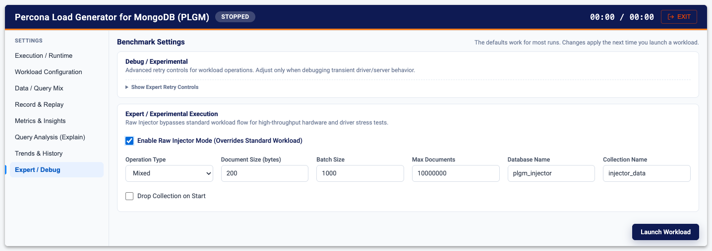

# Raw Injector Mode (High Performance Hardware Test)

The **Raw Injector** is a specialized, high-performance engine built directly into PLGM. Instead of using the standard MongoDB driver structs (which consume CPU and memory for BSON marshaling), the Raw Injector pre-compiles raw BSON byte arrays and performs zero-allocation bitwise mutations in a tight loop.

This mode is designed exclusively to **stress-test network throughput, disk I/O, and extreme CPU limits** of the MongoDB cluster. It can saturate high-end infrastructure significantly faster than standard workloads. It was developed to mimic other benchmarking tools, enabling an apples-to-apples comparison between PLGM and alternative solutions.

Unlike the other workloads PLGM supports, this mode is not a workload simulator: it does not use your collection or query definitions. It is a plain benchmark stress test. Record & Replay and deterministic traffic do not work with it.

***Important Note on Ops/Sec: In Raw Injector mode, the printed Ops/Sec refers to the number of documents processed, not the number of network commands. For example, if your batch size is 1,000, and plgm reports 50,000 Ops/Sec, it is executing 50 bulk network commands per second.***

[Back to the main README](../README.md)

---

## Run it from the Web UI

1. Start the UI with `./plgm --webui` and set your **MongoDB URI** on **Execution / Runtime**.
2. Open **Expert / Debug > Expert / Experimental Execution**.
3. Turn on **Enable Raw Injector Mode (Overrides Standard Workload)**.
4. Set:
   - **Operation Type**: Insert, Upsert, Update, Find, Delete, or Mixed. Run Insert first to create the data the other types work on.
   - **Document Size (bytes)**: size of the random binary payload.
   - **Batch Size**: operations packed into one network round trip.
   - **Max Documents**: total documents to generate or query.
   - **Database Name** and **Collection Name**.
   - **Drop Collection on Start**: on for a clean insert test.
5. Set **Duration** and **Concurrency (Active Workers)** on **Workload Configuration**.
6. Click **Launch Workload**.



## Understanding Raw Injector Throughput (Ops/Sec)

When running in **Raw Injector Mode**, the Web UI and CLI may report very high throughput numbers (e.g., 100,000+ Ops/Sec) that appear significantly higher than the command rates shown in Percona Monitoring and Management (PMM). This is expected behavior due to how the engine is built.

### Document-Level vs. Command-Level Metrics
The "Ops/Sec" reported by PLGM refers to individual **documents** processed. To achieve maximum performance, the Raw Injector bypasses standard BSON marshaling and groups thousands of operations into a single network round-trip command.

### The "Batch Size" Discrepancy
The relationship between PLGM reporting and standard "Opcounters" in PMM is defined by your configured `batch_size`.

* **PLGM Reporting**: Counts every individual document within a batch. For example, with a `batch_size` of **2,000**, a report of **100,000 Ops/Sec** means 100,000 records are being processed per second.
* **PMM Opcounters**: Standard monitoring counts the **network commands**. In the example scenario above, PMM Opcounters will show only **50 operations per second** (100,000 / 2,000 = 50).

***How to Verify High Throughput in PMM: To see PMM metrics that align with the high numbers in the PLGM dashboard, you must look at **Document Operations** (storage engine activity) rather than **Opcounters** (protocol activity).***

### Performance Note: Duplicate Keys
To maintain maximum stress-test velocity, the Raw Injector is programmed to ignore **Duplicate Key Errors** during `insert` or `mixed` workloads to prevent the generator from stalling. If you are inserting into a collection that already contains the target data, PLGM will report high "Ops/Sec" (attempts), but MongoDB's internal `inserted` counters in PMM will remain at **0** because the storage engine did not need to write new records.

## Configuration

You can configure the Raw Injector via `config.yaml` or directly via CLI flags/environment variables. These are the available options:

```yaml
# config.yaml snippet
raw_injector:
  enabled: true
  drop_collection: true
  type: "mixed"            # Options: insert, upsert, find, update, delete, mixed
  document_size: 1024      # Size of the random binary payload in bytes
  max_docs: 10000000       # Total documents to generate/query
  batch_size: 1000         # Number of operations packed into a single network round-trip
  db_name: "plgm_injector"
  collection_name: "injector_data"
```

Environment variables:

```bash
  PLGM_INJECTOR                       Enable Raw Injector mode (true/false)
  PLGM_INJECTOR_TYPE                  Operation: insert, upsert, update, delete, find, mixed
  PLGM_INJECTOR_SIZE                  Document size in bytes
  PLGM_INJECTOR_BATCH_SIZE            Operations per network batch (default: 1000)
  PLGM_INJECTOR_MAX_DOCS              Total documents to operate on (default: 10M)
  PLGM_INJECTOR_DROP                  Drop collection on start (true/false)
  PLGM_INJECTOR_DB                    Database name
  PLGM_INJECTOR_COLLECTION            Collection name
```

## Modes of Operation (type)

 * insert: Floods the database with new documents. Automatically pre-splits chunks if sharding is enabled.
 * find / update / delete: Operates on the existing data seeded by an insert run.
 * upsert: Fires upsert commands, creating documents if they don't exist.
 * mixed: Runs a randomized distribution of reads, inserts, updates, and deletes simultaneously.

## Running via CLI
You can bypass the YAML config entirely and trigger a raw injection test purely through flags:

### Run a pure insert flood, dropping existing data, with 4KB documents

```bash
./plgm -raw-injector -raw-injector-type=insert -raw-injector-drop -raw-injector-size=4096 -raw-injector-batch=2000
```

### Run a mixed workload against the generated data

```bash
./plgm -raw-injector -raw-injector-type=mixed
```

<details>
<summary>Sample output:</summary>

```bash
./plgm -raw-injector -raw-injector-type=insert -raw-injector-drop -raw-injector-size=4096 -raw-injector-batch=2000
  [INFO] Performance: Automatically disabled driver compression (compressors=none)
Enter Password for user 'root':
2026/02/23 11:26:45 [RawInjector] Dropping collection 'injector_data'...
2026/02/23 11:26:47 [RawInjector] Range sharding enabled on { _id: 1 }
2026/02/23 11:26:47 [RawInjector] Pre-splitting: 4 workers -> 2 shards
2026/02/23 11:26:48 >>> RAW INJECTOR START [mixed] workers=4 batch=2000 maxDocs=10000000 docSize=4096 <<<

> Starting Workload...

 TIME    | TOTAL OPS |  SELECT |  INSERT |  UPSERT |  UPDATE |  DELETE |    AGG | TRANS
 -----------------------------------------------------------------------------------------
 00:01   |    76,000 |  48,000 |  10,000 |       0 |  18,000 |       0 |      0 |     0
 00:02   |   160,000 | 108,000 |  10,000 |       0 |  30,000 |  12,000 |      0 |     0
 00:03   |   140,000 |  90,000 |  18,000 |       0 |  20,000 |  12,000 |      0 |     0
 00:04   |   142,000 |  78,000 |   8,000 |       0 |  38,000 |  18,000 |      0 |     0
 00:05   |   160,000 | 112,000 |  12,000 |       0 |  28,000 |   8,000 |      0 |     0
 00:06   |   140,000 |  78,000 |  12,000 |       0 |  34,000 |  16,000 |      0 |     0
 00:07   |   138,000 |  72,000 |   4,000 |       0 |  40,000 |  22,000 |      0 |     0
 00:08   |   156,000 |  98,000 |   4,000 |       0 |  44,000 |  10,000 |      0 |     0
 00:09   |   144,000 |  84,000 |   6,000 |       0 |  38,000 |  16,000 |      0 |     0
 00:10   |   180,000 | 126,000 |   4,000 |       0 |  34,000 |  16,000 |      0 |     0

> Workload Finished.

  SUMMARY
  --------------------------------------------------
  Runtime:    10.00s
  Total Ops:  1,444,000
  Avg Rate:   144,400 ops/sec

  LATENCY DISTRIBUTION (ms)
  --------------------------------------------------
  TYPE             AVG          MIN          MAX          P95          P99
  SELECT       0.01 ms      0.01 ms      0.03 ms      0.00 ms      0.00 ms
  INSERT       0.07 ms      0.04 ms      0.15 ms      0.00 ms      0.00 ms
  UPSERT             -            -            -            -            -
  UPDATE       0.04 ms      0.04 ms      0.07 ms      0.00 ms      0.00 ms
  DELETE       0.04 ms      0.03 ms      0.06 ms      0.00 ms      0.00 ms
  AGG                -            -            -            -            -
  TRANS              -            -            -            -            -
```
</details>

### Run the workload configuring it via any of the available environment variables

<details>
<summary>Sample output:</summary>

```bash
export PLGM_PASSWORD=super_duper_password_here
PLGM_INJECTOR=true PLGM_INJECTOR_TYPE=mixed PLGM_DURATION=30s ./plgm
  [INFO] Performance: Automatically disabled driver compression (compressors=none)
2026/02/23 11:48:26 [RawInjector] Range sharding enabled on { _id: 1 }
2026/02/23 11:48:26 [RawInjector] Pre-splitting: 4 workers -> 2 shards
2026/02/23 11:48:27 [RawInjector] Checking for existing data to resume sequences...
2026/02/23 11:48:27 >>> RAW INJECTOR START [mixed] workers=4 batch=1000 maxDocs=10000000 docSize=200 <<<

> Starting Workload...

 TIME    | TOTAL OPS |  SELECT |  INSERT |  UPSERT |  UPDATE |  DELETE |    AGG | TRANS
 -----------------------------------------------------------------------------------------
 00:01   |    65,000 |  41,000 |   4,000 |       0 |  11,000 |   9,000 |      0 |     0
 00:02   |    79,000 |  53,000 |   3,000 |       0 |  14,000 |   9,000 |      0 |     0
 00:03   |    85,000 |  52,000 |   4,000 |       0 |  18,000 |  11,000 |      0 |     0
 00:04   |    77,000 |  44,000 |   3,000 |       0 |  21,000 |   9,000 |      0 |     0
 00:05   |    93,000 |  53,000 |   9,000 |       0 |  16,000 |  15,000 |      0 |     0
 00:06   |    98,000 |  63,000 |   4,000 |       0 |  24,000 |   7,000 |      0 |     0
 00:07   |    99,000 |  70,000 |   1,000 |       0 |  17,000 |  11,000 |      0 |     0
 00:08   |    93,000 |  54,000 |   4,000 |       0 |  26,000 |   9,000 |      0 |     0
 00:09   |   121,000 |  84,000 |   8,000 |       0 |  18,000 |  11,000 |      0 |     0
 00:10   |    96,000 |  55,000 |   6,000 |       0 |  29,000 |   6,000 |      0 |     0
 00:11   |   113,000 |  73,000 |   7,000 |       0 |  23,000 |  10,000 |      0 |     0
 00:12   |   102,000 |  67,000 |   4,000 |       0 |  18,000 |  13,000 |      0 |     0
 00:13   |   124,000 |  87,000 |   7,000 |       0 |  26,000 |   4,000 |      0 |     0
 00:14   |   114,000 |  73,000 |   6,000 |       0 |  27,000 |   8,000 |      0 |     0
 00:15   |   117,000 |  73,000 |  12,000 |       0 |  20,000 |  12,000 |      0 |     0
 00:16   |   109,000 |  67,000 |   5,000 |       0 |  31,000 |   6,000 |      0 |     0
 00:17   |   127,000 |  89,000 |   9,000 |       0 |  15,000 |  14,000 |      0 |     0
 00:18   |   121,000 |  86,000 |   2,000 |       0 |  19,000 |  14,000 |      0 |     0
 00:19   |   116,000 |  78,000 |   4,000 |       0 |  16,000 |  18,000 |      0 |     0
 00:20   |   105,000 |  71,000 |   5,000 |       0 |  18,000 |  11,000 |      0 |     0
 00:21   |   129,000 |  91,000 |   9,000 |       0 |  24,000 |   5,000 |      0 |     0
 00:22   |   121,000 |  83,000 |   3,000 |       0 |  27,000 |   8,000 |      0 |     0
 00:23   |   130,000 |  94,000 |   4,000 |       0 |  22,000 |  10,000 |      0 |     0
 00:24   |   118,000 |  82,000 |   6,000 |       0 |  18,000 |  12,000 |      0 |     0
 00:25   |   111,000 |  71,000 |   7,000 |       0 |  21,000 |  12,000 |      0 |     0
 00:26   |   109,000 |  74,000 |   5,000 |       0 |  20,000 |  10,000 |      0 |     0
 00:27   |   117,000 |  77,000 |   3,000 |       0 |  25,000 |  12,000 |      0 |     0
 00:28   |   111,000 |  72,000 |   5,000 |       0 |  28,000 |   6,000 |      0 |     0
 00:29   |   118,000 |  76,000 |   6,000 |       0 |  27,000 |   9,000 |      0 |     0
 00:30   |   111,000 |  67,000 |   6,000 |       0 |  25,000 |  13,000 |      0 |     0

> Workload Finished.

  SUMMARY
  --------------------------------------------------
  Runtime:    30.00s
  Total Ops:  3,233,000
  Avg Rate:   107,766 ops/sec

  LATENCY DISTRIBUTION (ms)
  --------------------------------------------------
  TYPE             AVG          MIN          MAX          P95          P99
  SELECT       0.02 ms      0.01 ms      0.06 ms      0.00 ms      0.00 ms
  INSERT       0.02 ms      0.01 ms      0.05 ms      0.00 ms      0.00 ms
  UPSERT             -            -            -            -            -
  UPDATE       0.07 ms      0.04 ms      0.23 ms      0.00 ms      0.00 ms
  DELETE       0.09 ms      0.05 ms      0.17 ms      0.00 ms      0.00 ms
  AGG                -            -            -            -            -
  TRANS              -            -            -            -            -
```

</details>
