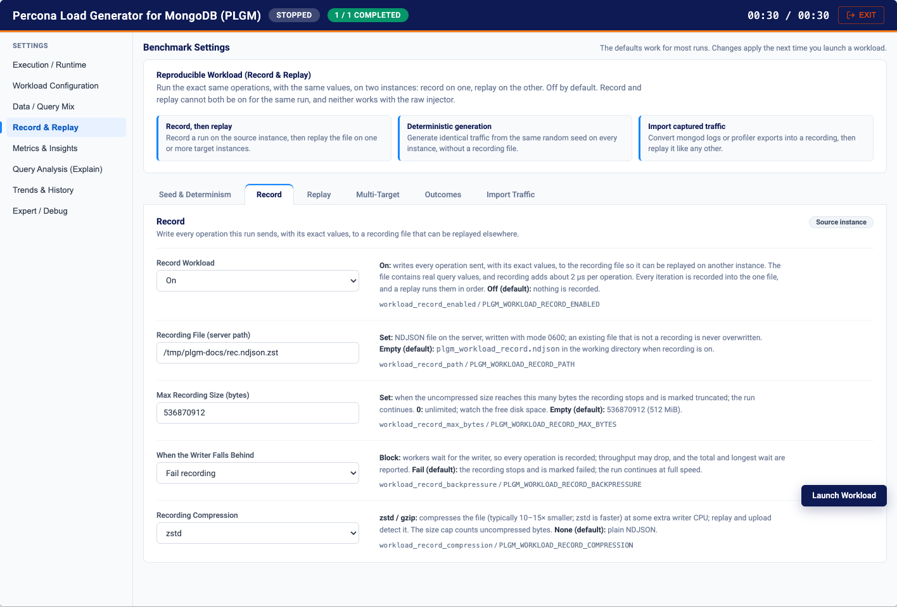
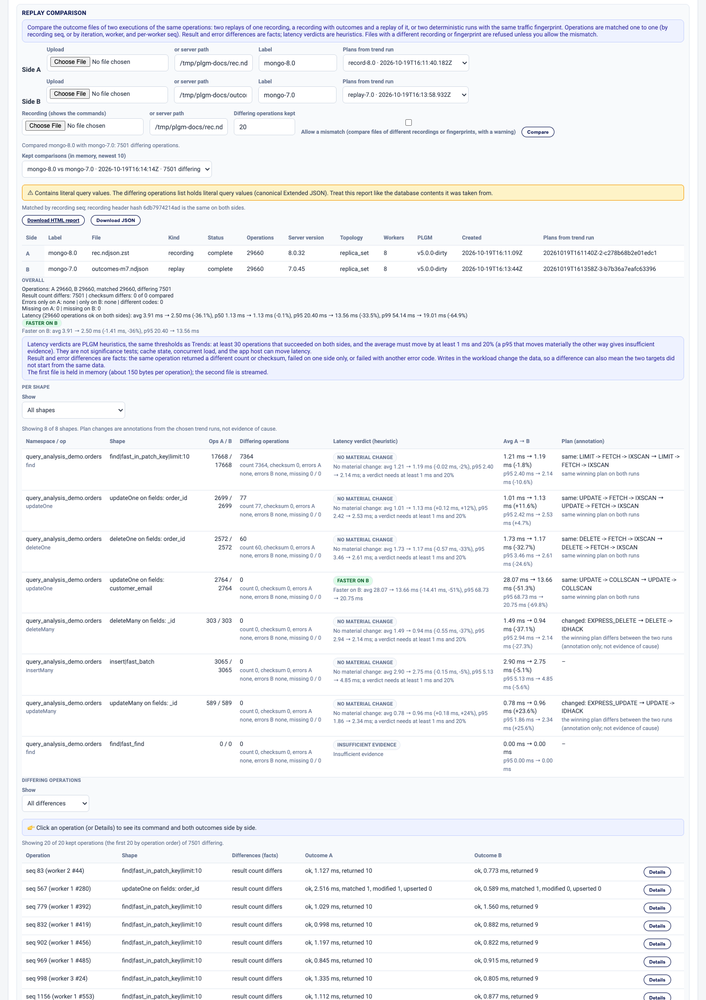

# Record and Replay

Send the exact same operations, with the same values, to two or more MongoDB instances, then compare what each one returned and how fast, operation by operation. This is the tool for upgrade and migration testing: record on the version you run today, replay on the version you are moving to, and read the differences.

Every setting on this page is off by default. With the defaults, runs, recordings, and stored trends behave exactly as before.

[Back to the main README](../README.md)

- [Quick start in the Web UI](#quick-start-in-the-web-ui)
- [Comparing Two Instances (Upgrade Testing)](#comparing-two-instances-upgrade-testing)
- [Record and Replay settings](#record-and-replay-settings)
- [Deterministic Generated Traffic](#deterministic-generated-traffic)
- [Operation Outcomes](#operation-outcomes)
- [Compare Replays](#compare-replays)
- [Multi-Target Replay](#multi-target-replay)
- [Preparing identical starting data](#preparing-identical-starting-data)
- [Import Captured Traffic](#import-captured-traffic)

---

## Quick start in the Web UI

Start the UI with `./plgm --webui`. All settings below are on the **Record & Replay** settings tab, split into six sub-tabs: **Seed & Determinism**, **Record**, **Replay**, **Multi-Target**, **Outcomes**, and **Import Traffic**. Every setting shows what happens when it is on and when it is off, along with its `config.yaml` key and environment variable.

The test takes three runs: record on the current server, replay on the new server, and compare.

### Step 1: Record on the current instance

1. **Execution / Runtime**: set **MongoDB URI** to the current server.
2. **Data / Query Mix**: pick your collection and query definitions, set **Seed Document Count**, turn **Drop Collections First** on, and turn **Skip Seed Phase** off.
3. **Record & Replay > Seed & Determinism**: set **Random Seed** to any non-zero value (for example `42`). The same seed gives both servers identical starting documents.
4. **Record & Replay > Record**:
   - **Record Workload**: On.
   - **Recording File (server path)**: for example `rec.ndjson.zst`.
   - **Recording Compression**: `zstd`.
   - For long or busy runs, set **When the Writer Falls Behind** to **Block workers** so every operation is captured.
5. **Record & Replay > Multi-Target**: set **Starting-Data Fingerprint** to **Counts and indexes**. Every replay then checks that its target starts with the same data.
6. **Record & Replay > Outcomes**: **Record Outcomes**: On. Optionally turn on **Result Checksums** to compare the actual documents returned.
7. Click **Launch Workload** (bottom right).



### Step 2: Replay on the new instance

1. **Execution / Runtime**: change **MongoDB URI** to the new server. Leave the seed and data settings unchanged.
2. **Record & Replay > Record**: **Record Workload**: Off. Record and replay cannot both be on.
3. **Record & Replay > Replay**:
   - **Replay Workload**: On.
   - **Recording to Replay (server path)**: the file from step 1, or use **or upload a recording**.
   - **Replay Mode**: **Per worker** sends operations as fast as possible; **Timed** keeps the recorded pacing and reports lag.
   - **Replay Operations**: **Reads only** if writes must not change the target's data.
4. **Record & Replay > Outcomes**: keep **Record Outcomes** On and set **Replay Outcome File (server path)**, for example `outcomes-new.ndjson`.
5. Click **Launch Workload**.

### Step 3: Compare

1. On the dashboard, open **Query & Index Analysis > Replay Comparison**.
2. Side A: the recording file (it holds the outcomes from step 1), label `current`.
3. Side B: `outcomes-new.ndjson`, label `new`.
4. Optional: add the recording under **Recording (shows the commands)** to see the command behind each differing operation.
5. Click **Compare**. Click any differing operation to see both sides, and download the report as HTML or JSON.

The screenshot shows a recording made on MongoDB 8.0 (side A) compared with its replay on MongoDB 7.0 (side B), with plans taken from both trend runs. The top shows the two sides and the overall verdict. Next is the per-shape table with latency verdicts and plan changes, and the first differing operations are at the bottom:



### Shortcut: replay on several servers in one run

Instead of step 2, open **Record & Replay > Multi-Target**, click **Add target** for each server (2 to 8, each with a label such as `m8` and a URI), choose **Sequential** or **Concurrent** in **Targets Mode**, and set the **Replay Outcome File**. One launch replays on every target and compares each one with the first. The UI asks for confirmation before a run that replays writes, drops, or seeds targets.

### Replaying real application traffic

Use **Record & Replay > Import Traffic**: choose your mongod JSON logs or `system.profile` export in **Captured Traffic Files**, click **Convert**, then **Use for replay**. Continue with step 2. See [Import Captured Traffic](#import-captured-traffic).

> **Handle these files like production data.** Recordings, outcome files, comparison reports, and trend stores with query values enabled contain real query values.

---

## Comparing Two Instances (Upgrade Testing)
To test an upgrade or a configuration change the way `pt-upgrade` did, send the same
operations with the same values to two copies of the same data (for example MongoDB 8 and
9) and compare what changed. Every piece is opt-in and off by default.

| Goal | Use |
| --- | --- |
| Same PLGM-generated workload on each instance for a set length of time, no file | [Deterministic Generated Traffic](#deterministic-generated-traffic) (`workload_deterministic` + `random_seed` + `operations_per_worker` + `duration`) |
| Exact operations captured once, replayed anywhere (also across PLGM versions or config changes) | [Record and Replay settings](#record-and-replay-settings) |
| Real application traffic | [Import Captured Traffic](#import-captured-traffic) (`plgm import-traffic`), then replay |
| Per-operation results to compare | [Operation Outcomes](#operation-outcomes) (`workload_record_outcomes`, optional result checksums) |
| The A-vs-B report | [Compare Replays](#compare-replays) (`plgm compare-replays` or Query Analysis > Replay Comparison) |
| Several instances in one run | [Multi-Target Replay](#multi-target-replay) (sequential or concurrent, each compared with the first) |
| Did two ordinary benchmark runs use the same query values? | **Store query values** (`insights_trend_store_query_values`, see [Trends and History](./trends-and-history.md#store-query-values)) |

A typical upgrade test:

1. Prepare identical starting data on each target (same `random_seed` seeding, or restore
   the same snapshot; see [Preparing identical starting data](#preparing-identical-starting-data)).
2. Record a run with outcomes on the current version (`workload_record_enabled`,
   `workload_record_outcomes`, optionally `workload_record_backpressure: block` and
   `workload_record_compression: zstd`), or import captured traffic.
3. Replay the recording on the targets with `workload_replay_targets` (or one replay per
   target with `workload_replay_outcomes_path`), optionally `workload_replay_ops: reads_only`
   so writes do not make the targets diverge.
4. Read the comparison: per shape and overall op counts, latency deltas (heuristic
   verdicts), result and error differences (facts), and the top differing operations.

The same test from `config.yaml` and the command line:

```yaml
# Run 1: record on the current version
uri: mongodb://current-host:27017
random_seed: 42
drop_collections: true
skip_seed: false
workload_record_enabled: true
workload_record_path: rec.ndjson.zst
workload_record_compression: zstd
workload_record_outcomes: true
workload_data_fingerprint: counts
```

```yaml
# Run 2: replay on the new version
uri: mongodb://new-host:27017
random_seed: 42
drop_collections: true
skip_seed: false
workload_replay_enabled: true
workload_replay_path: rec.ndjson.zst
workload_record_outcomes: true
workload_replay_outcomes_path: outcomes-new.ndjson
```

```bash
./plgm compare-replays --label-a current --label-b new rec.ndjson.zst outcomes-new.ndjson
```

Recordings, outcome files, and comparison reports can contain literal query values: they are
written with mode 0600 and never included in `/api/insights`, trend baselines, or Download
Summary. Trend rows of two replays of the same recording (or two runs with the same
generated-traffic fingerprint) are annotated as `same_values` without storing literals;
improved/regressed labels never change.

## Record and Replay settings
Run the exact same operations, with the same values, on two instances: record on one,
replay on the other. All settings are on the Web UI's **Record & Replay** tab (sub-tabs
**Seed & Determinism**, **Record**, **Replay**, **Multi-Target**, **Outcomes**, and
**Import Traffic**) and are off by default. Record and replay cannot both be on for the
same run, and neither works with the raw injector.

- **Random seed** (`random_seed`, UI: Seed & Determinism > **Random Seed**). Set (non-zero): seeds data and query generation, so the
  same seed, documents count, and collection definitions seed identical documents on any
  instance; use it on both sides of a replay. 0 (default): values are time-based and differ
  every run.
- **Record workload** (`workload_record_enabled`, UI: Record > **Record Workload**). On: writes every operation sent, with its
  exact values, to the recording file so it can be replayed on another instance. The file
  contains real query values, and recording adds about 2 µs per operation. Every iteration
  is recorded into the one file, and a replay runs them in order. Off (default): nothing is
  recorded.
- **Recording file** (`workload_record_path`, UI: Record > **Recording File (server path)**). Set: NDJSON file, written with mode 0600; an
  existing file that is not a recording is never overwritten. Empty (default):
  `plgm_workload_record.ndjson` in the working directory when recording is on.
- **Max recording size** (`workload_record_max_bytes`, UI: Record > **Max Recording Size (bytes)**). Set: when the uncompressed size
  reaches this many bytes the recording stops and is marked truncated; the run continues.
  0: unlimited; watch the free disk space. Empty (default): 536870912 (512 MiB).
- **When the writer falls behind** (`workload_record_backpressure`, UI: Record > **When the Writer Falls Behind**). `block`: workers wait
  for the writer, so every operation is recorded; throughput may drop, and the total and
  longest wait are reported. `fail` (default): the recording stops and is marked failed;
  the run continues at full speed.
- **Recording compression** (`workload_record_compression`, UI: Record > **Recording Compression**). `zstd` / `gzip`: compresses
  the file (typically 10–15x smaller; zstd is faster) at some extra writer CPU; replay and
  upload detect it from the file's first bytes. The size cap counts uncompressed bytes.
  `none` (default): plain NDJSON.
- **Replay workload** (`workload_replay_enabled`, UI: Replay > **Replay Workload**). On: no operations are generated; the
  recorded operations run on the recorded worker count until the file ends. Duration, load
  profile, access pattern, and think time are ignored. Iterations is ignored too: the
  replay runs once and replays every recorded iteration in order. Off (default):
  operations are generated as usual.
- **Recording to replay** (`workload_replay_path`, UI: Replay > **Recording to Replay (server path)** or **or upload a recording**). Set: the
  recording to replay; an uploaded file is used instead of the path and deleted after the
  run. Empty (default): nothing to replay; required when replay is on.
- **Replay mode** (`workload_replay_mode`, UI: Replay > **Replay Mode**). `timed`: sends each operation at its recorded
  offset from the start and reports how far behind it fell (lag). `per_worker` (default):
  each worker sends its recorded operations in order, as fast as possible.
- **Replay operations** (`workload_replay_ops`, UI: Replay > **Replay Operations**). `reads_only` replays finds and read-only aggregates
  and skips every write (inserts, updates, deletes, transactions with a write, aggregates with
  `$out`/`$merge`), so the target keeps its starting data; skipped writes are counted and
  reported, and the commands hash is not compared. `all` (default): replays every recorded
  operation, including writes.
- **Allow mismatch** (`workload_replay_allow_mismatch`, UI: Replay > **Allow Mismatch**). On: replays even when the
  collection/query definitions or namespaces differ from the recording, or the recording
  did not complete; results may not be comparable. Off (default): such a replay fails
  before any operation is sent.

**Recording long runs.** For a complete capture of a long, high-throughput run, set
`workload_record_backpressure: block`, `workload_record_compression: zstd`, and
`workload_record_max_bytes: 0`. With `iterations` > 1, each operation line carries its
iteration and the header records the iteration count and `interval_delay`; a replay runs
iteration 2 only after every operation of iteration 1 finished, and `timed` mode also keeps
the recorded gap between iterations. The run metadata (`recording` in `/api/insights`)
reports the policy, bytes written (uncompressed), bytes on disk, the compression ratio, and,
with `block`, how often and how long workers waited; the same is logged at the end.

One writer goroutine writes the file. Measured on an Apple M-series laptop with varied
find/update/insert commands, it sustains about 900,000 operations/s uncompressed, 690,000
with zstd (files about 14x smaller), and 540,000 with gzip (about 11x smaller); a worker
pays about 2 µs per operation to encode its command. Above that rate the queue fills: `fail`
stops the recording, `block` slows the workers. Run
`go test ./internal/workloadrec -run x -bench Recorder` to measure your host.

## Deterministic Generated Traffic
Use this when you want the same generated workload, with the same values, on two
instances, for a set amount of time, without saving a recording file. A typical case is
a 30-second comparison of two MongoDB versions that start from the same seeded data.

Settings are on **Record & Replay > Seed & Determinism** and are off by default.

**Duration is how long the measured run lasts.** **Operations per Worker** is one pass
of that workload, not a reason to stop early. Each worker sends that many operations,
then keeps going with the next operations of the same workload until Duration ends.
A failed operation or a retried transaction does not change the values of later
operations. Each operation's values come from the random seed, the iteration, the
worker, and the operation number.

Example: 4 workers, Operations per Worker 100, Duration 30 seconds. One pass is
4 × 100 = 400 operations. If the database finishes those in about a second, the workers
continue until the clock reaches 30 seconds. The run is one run, not a new launch.

**In the Web UI:**

1. **Workload Configuration**: set **Duration** (for example `30s`) and a fixed **Concurrency**.
2. **Record & Replay > Seed & Determinism**: set **Random Seed** (non-zero), turn on **Deterministic traffic**, and set **Operations per Worker**. Turning **Deterministic traffic** on also turns **Drop Collections First** on, turns **Skip Seed Phase** off, and sets **Load Profile** to **Fixed**. Turning it off restores the previous values.
3. Optional, to compare later: **Record & Replay > Outcomes**: turn on **Record Outcomes** and set **Deterministic Outcome File (server path)**.
4. Click **Launch Workload**. Repeat on the second instance with the same settings, including the same Duration.

**How to read the dashboard**

- While seeding, the header clock counts preparation time and ends with `init`. That time is not part of the 30 seconds.
- When execution starts, the clock is execution time out of Duration, for example `00:04 / 00:30`. It keeps moving until Duration ends.
- **FINISHED** and `1 / 1 COMPLETED` mean the run lasted for Duration. The note under the header says how many operations were sent and that the smaller number is one pass. In the example, one pass is 400; a 30-second run sends more than 400.
- **INCOMPLETE** and **BUDGET NOT FINISHED** mean Duration ended before every worker finished even one pass. The workload was too large for that time, or the database was too slow. Raise Duration or lower Operations per Worker. The note gives the reason.
- The operation tiles (Find, Insert, Update, Delete, Aggregate) count what the database did. A bulk insert counts each document, so Insert can be higher than the number of insert commands. The pass size in the note is commands, not documents.
- The traffic fingerprint, on the dashboard, in Download Summary, and in the HTML report, identifies the **first pass only**. The same fingerprint means those first operations were the same commands, in the same per-worker order. It does not mean both runs sent the same total. A faster instance fits more operations into the same Duration, so **sent** can be higher than **planned**. Planned is workers × Operations per Worker × iterations (one pass). Sent is everything that actually ran.

Only hashes are stored, never query values. In Trends, two complete runs with the same fingerprint are annotated `same_generated_traffic`, and their query values count as `same_values`. That does not change the improved or regressed labels.

**Settings:**

- **Deterministic traffic** (`workload_deterministic`). On: generate the workload as described above. Off (default): generate operations as usual until Duration ends, with no fixed pass and no fingerprint.
- **Operations per Worker** (`operations_per_worker`). The size of one pass. Required when deterministic traffic is on, and it must be greater than 0. 0 (default): no pass; workers simply run until Duration ends.

Turning **Deterministic traffic** on in the Web UI sets `drop_collections`, clears `skip_seed`, and selects a fixed load profile.

Requirements, checked before the run starts (the Web UI opens the Workload tab): a non-zero
`random_seed`; `operations_per_worker` > 0; `drop_collections` on and `skip_seed` off, so the
records a query looks up are the seeded documents, regenerated from the seed instead of read
from the database (or the worker's own inserts, with deterministic `_id`s); a fixed worker
count (a load profile that changes concurrency is rejected); no replay and no raw injector.
Think time and access patterns are allowed. The insert cache and bootstrap are not used.
With `iterations` > 1, each iteration is part of how operations are derived, and the whole
run has one fingerprint. Each iteration still lasts for Duration.

These things can still differ between two runs: the order in which workers' operations
interleave, and therefore locks, cache, and timing on the server; values the server fills
in (for example `$currentDate` or `$$NOW`); results when the starting data differs; a
filter field that follows the shard key on a sharded collection; and any change to PLGM's
version or to the collection or query definitions, which changes the fingerprint.

## Operation Outcomes
Keep what every operation returned so two executions of the same traffic can be compared
offline. Settings are on **Record & Replay > Outcomes** and are off by default.

- **Record outcomes** (`workload_record_outcomes`, UI: **Record Outcomes**). Each operation gets an `outcome`: client
  latency (`latency_us`), `ok`, or the server error code and code name (`error_code`,
  `error_name`; client-side failures get `client_timeout`, `cancelled`, `network_error`, or
  `client_error`). The error message is never stored, because it can contain values. The
  result summary depends on the operation: find/aggregate `returned`; insert `inserted`;
  update `matched`, `modified`, `upserted`; delete `deleted`; transaction `commit`/`abort`.
- **Result checksums** (`workload_record_result_checksums`, UI: **Result Checksums**). Adds `checksum`: a sha256 over
  the returned documents in order, each as canonical Extended JSON with the keys inside each
  document sorted (so a different result order, array order, or BSON type changes it, but the
  stored field order does not).
- **Replay outcome file** (`workload_replay_outcomes_path`, UI: **Replay Outcome File (server path)**). Where a replay writes its outcomes.
- **Deterministic outcome file** (`workload_deterministic_outcomes_path`, UI: **Deterministic Outcome File (server path)**). Where a deterministic run writes its outcomes.

Where the outcomes go: a recording stores them inline on each operation line (with outcomes
off, the recording is byte-for-byte what it was). A replay needs
`workload_replay_outcomes_path` and writes `outcome` lines carrying the recording's `seq`,
worker, and worker sequence, with the recording header hash in the file header. A
deterministic run writes `workload_deterministic_outcomes_path` (keyed by iteration, worker,
and operation number, with the traffic fingerprint in the trailer) or, when recording, the
recording. Outcome files are NDJSON (`plgm-workload-outcomes/1`), mode 0600; the writer
never drops a line (workers wait for it, and waits are reported). Run metadata
`outcome_file` in `/api/insights` reports the path, count, status, and hashes only. The
commands sent, stats, insights, and trends do not change.

Cost, measured on an Apple M-series laptop: under 0.1 µs per operation on the worker and
about 0.7 µs per outcome-file line; with checksums, about 5 µs of worker CPU and a copy for
every returned document, spent after the latency is measured. Run
`go test ./internal/workloadrec ./internal/mongo -run x -bench 'Outcome|ResultHash'` to
measure your host.

## Compare Replays
Compare two executions of the same operations, for example the same recording replayed
against MongoDB 8.0 and 9.0.

**In the Web UI:** open **Query & Index Analysis > Replay Comparison**. For side A and side B, either upload a file or enter a server path, and give each side a **Label**. Optionally pick **Plans from trend run** for each side, add the recording under **Recording (shows the commands)**, and set **Differing operations kept**. Click **Compare**. Earlier reports are listed under **Kept comparisons**.

**From the command line:**

```bash
./plgm compare-replays --label-a mongo-8 --label-b mongo-9 --recording rec.ndjson \
  outcomes-8.ndjson outcomes-9.ndjson
# writes plgm_replay_compare.json and plgm_replay_compare.html (mode 0600)
```

- **Inputs.** Two replay outcome files of one recording, a recording with outcomes and a
  replay of it, or two deterministic outcome files. Operations are matched by recording `seq`
  (replays) or by iteration, worker, and per-worker sequence (deterministic runs). Files with a
  different recording header hash or traffic fingerprint are refused;
  `--allow-mismatch` compares anyway and prints a warning.
- **Report, per shape and overall.** Operation counts; latency avg/p50/p95/p99 for each side
  with the change in percent; result count and checksum differences; errors on one side only,
  by code; operations missing on one side; and the first `--top` (default 20) differing
  operations with both outcomes. Each side shows its server version and topology (topology is
  stored by files written from this version on).
- **Facts and heuristics.** Result and error differences are facts. Latency verdicts (slower,
  faster, no material change, insufficient evidence) use the Trends thresholds: at least 30
  operations that succeeded on both sides, and the average must move by at least 1 ms and 20%.
  They are heuristics, not significance tests. Writes change the data, so a result difference
  can also mean the two targets did not start from the same data.
- **Commands.** The differing operations show their command only when a recording is given
  (`--recording`, or a recording as one side); the report then contains literal query values
  and says so. Deterministic outcome files do not store commands.
- **Plans (annotation only).** `--trend-store FILE --plans-a-run ID --plans-b-run ID` adds the
  explain plan of each shape from two stored trend runs, and notes when it changed.
- **Memory.** The first file is held in memory (about 150 bytes per operation); the second is
  streamed.

In the Web UI, the comparison opens each differing operation side by side in the
shape detail dialog. Reports are kept in server memory only (newest 10) and download as HTML or
JSON. Trend rows of two replays of the same recording show **same values** (source
`same_recording`, no stored literals) and link to a kept comparison of that recording.

## Multi-Target Replay
Replay one recording (or run one deterministic workload) on several instances and compare
each with the first, in one run.

**In the Web UI:**

1. Set up the replay (or deterministic traffic) and outcomes as in the [quick start](#quick-start-in-the-web-ui).
2. **Record & Replay > Multi-Target**: click **Add target** for each instance (2 to 8). Give each a short label (for example `m8`) and its URI. The **MongoDB URI** on Execution / Runtime is not used.
3. **Targets Mode**: **Sequential** (one after another) or **Concurrent** (all at once from this host).
4. **Starting-Data Fingerprint**: **Counts and indexes** to check every target before the first operation.
5. Click **Launch Workload** and confirm. The comparisons appear in **Query & Index Analysis > Replay Comparison**.

**From the command line:**

```bash
./plgm --replay-target m7=mongodb://h7:27017 --replay-target m8=mongodb://h8:27017 \
  --replay-target m9=mongodb://h9:27017 --replay-targets-mode concurrent config.yaml
# config.yaml: workload_replay_enabled, workload_replay_path, workload_record_outcomes,
# workload_replay_outcomes_path: outcomes.ndjson
# writes outcomes.m7.ndjson, outcomes.m8.ndjson, outcomes.m9.ndjson and
# outcomes.compare.m7-vs-m8.json/.html, outcomes.compare.m7-vs-m9.json/.html (mode 0600)
```

- **Only listed targets.** With `workload_replay_targets` set, operations, setup (drop,
  indexes, seed), and explain go only to the listed targets; `uri` is not used. Username,
  password, and TLS settings apply to every target; per-target options (replica set name,
  auth source) go in each target's URI. Logs and the API name targets by label, never by URI.
  The Web UI asks for confirmation before a run that replays writes, drops, or seeds targets.
- **Per target.** Each target has its own client, workers, stats collector, outcome file (the
  label goes before the extension), run metadata (`target` in `/api/insights`), insights, and
  trend run (label `<trend_run_label>-<label>`, or the label). After the run, every target is
  compared with the first, exactly as [Compare Replays](#compare-replays) does; the CLI writes
  the reports next to the outcome files, and the Web UI keeps them with the other replay
  comparisons, linked to the targets' trend runs. A failed target does not stop the others.
- **Sequential (default) or concurrent.** Sequential prepares and runs one target after
  another. Concurrent prepares every target first, one at a time, then starts all workloads at
  once; the targets share this host's CPU, memory, and network, so latencies may be affected.
  Each replay then measures its client-side lag behind the recorded timeline (also in
  `per_worker` mode, where it does not wait), and the summary, run report, and comparisons
  show it. In the CLI, the per-interval lines of concurrent targets interleave; each line
  starts with its target's `[label]`.
- **Deterministic traffic.** With `workload_deterministic` instead of a replay, each target
  runs the same workload for the same Duration. The run checks that every target reports
  the reference's traffic fingerprint, which is the first pass. A faster target can send
  more operations after that pass, so a comparison can show extra operations on that side
  even when the fingerprint matches.
- **Reads only.** `workload_replay_ops: reads_only` skips every write, so targets keep their
  starting data; skipped operations are counted (`ops_skipped`) and the comparison warns when
  only one side skipped writes.
- **Dashboard.** The live dashboard shows per-target status, progress, elapsed time, lag, and
  the starting-data check; it follows the running target (sequential) or the first target
  (concurrent).

## Preparing identical starting data
A comparison is meaningful only if every target starts from the same data. Either:

1. **Same seed.** Let PLGM seed each target: the same `random_seed`, `documents_count`,
   collection definitions, `drop_collections: true`, and `skip_seed: false` seed identical
   documents (and `_id`s) on every target. Record on a target seeded the same way.
   In the UI: the same **Random Seed** and **Seed Document Count**, **Drop Collections First** on, **Skip Seed Phase** off.
2. **Restore a copy.** Restore the same snapshot or `mongodump` on every target and run with
   `skip_seed: true` and `drop_collections: false`.
   In the UI: **Skip Seed Phase** on, **Drop Collections First** off.

Set `workload_data_fingerprint: counts` (UI: **Starting-Data Fingerprint > Counts and indexes**) when recording to store each collection's document
count and index list in the recording header; every replay compares them with its target
before sending anything and fails on a difference (`workload_replay_allow_mismatch` turns it
into a warning). `dbhash` (**Counts, indexes, and dbHash**) also stores the `dbHash` collection hashes; they compare stored BSON
bytes, so they match only byte-identical copies (option 2): documents seeded separately can
store their fields in a different order and differ while holding the same values. `dbHash`
needs the dbHash privilege and does not run through mongos.

## Import Captured Traffic
Replay real application traffic instead of PLGM-generated load (pt-upgrade's log replay):
convert mongod JSON logs (4.4+), a mongoexport of `system.profile` (NDJSON or `--jsonArray`),
or raw command documents (plain, gzip, or zstd) into a normal recording, then replay it with
[Record and Replay](#record-and-replay-settings), outcomes, [Multi-Target Replay](#multi-target-replay),
and [Compare Replays](#compare-replays).

**In the Web UI:**

1. Open **Record & Replay > Import Traffic**.
2. Choose one or more files in **Captured Traffic Files**.
3. Optional: set **Import Workers** (maps connections onto N workers), **Default Database**, **Imported Recording Compression**, and **Skip server-generated values**.
4. Click **Convert**. The import report lists what was converted, skipped, and flagged.
5. Click **Use for replay** to set the replay path to the converted file, or **Download recording** to save it.
6. Because the recording runs against data you restored yourself, turn **Skip Seed Phase** on and **Drop Collections First** off on **Data / Query Mix**, then replay as in [step 2 of the quick start](#step-2-replay-on-the-new-instance).

The server keeps the newest 5 converted files (mode 0600) and deletes them when it is shut down from the UI.

**From the command line:**

```bash
./plgm import-traffic mongod.log mongod.log.1.gz --out captured.ndjson.zst --compression zstd
# then: workload_replay_enabled: true, workload_replay_path: captured.ndjson.zst,
#       drop_collections: false, skip_seed: true (each target restored from a copy of the data)
```

- **Capture first.** Logs and the profiler hold only operations slower than `slowms` (default
  100 ms), sampled by `slowOpSampleRate`. To capture everything, set profiling level 2 or
  `slowms: 0` while the application runs (this costs server CPU and disk); otherwise the
  import replays only the slow share of the traffic.
- **Order, timing, workers.** Operations are ordered by start time (logged time minus logged
  duration), and offsets are relative to the first one, so `workload_replay_mode: timed`
  keeps the captured pacing. Each connection (log `ctx`, profiler session id, or client and
  app name) becomes a worker, up to 1024; `--workers N` maps connections onto N workers.
  Several files are merged in start-time order.
- **Converted:** find (filter, projection, sort, skip, hint, limit, batch size), aggregate
  (pipeline, hint), insert (one or many documents), update and delete statements (one
  operation each; `multi`/`limit` choose updateMany/updateOne, deleteMany/deleteOne). Field
  order and BSON types (relaxed Extended JSON in logs) are kept. Session, routing, and
  read/write-concern fields are dropped.
- **Skipped and counted:** getMore (its find or aggregate replays as a whole), truncated
  commands (`truncated` in logs, `$truncated` in the profiler), other commands (count,
  distinct, findAndModify, ...), replacement-style updates, database-level and `$changeStream`
  aggregates, `admin`/`local`/`config` and `system.*` namespaces, per-statement WRITE log
  lines (the COMMAND line of the same write is used), and unparseable lines.
- **Flagged (replayed, not exactly as captured):** `server_generated_values` (inserts or
  upserts without `_id`, `$currentDate`, `$$NOW`, `$$CLUSTER_TIME`, `$rand`, `$sample`;
  `--skip-server-generated` skips them instead), `dropped_options` (for example
  `arrayFilters`, `collation`), `in_transaction` (replayed outside a transaction),
  `split_statement`, `failed_on_source`, and `no_timestamp`.
- The recording header carries `import` (sources, files, counts, the capture note); a replay
  does not compare collection or query definitions for it, runs every operation on its
  captured namespace, reports `imported_from`, and warns when drop or seeding was on. The
  recording contains literal values; the import report holds only counts and names.
