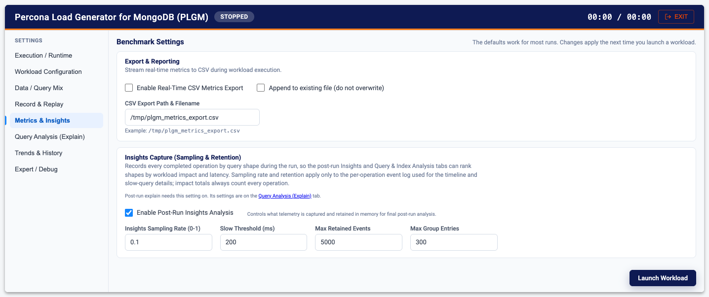
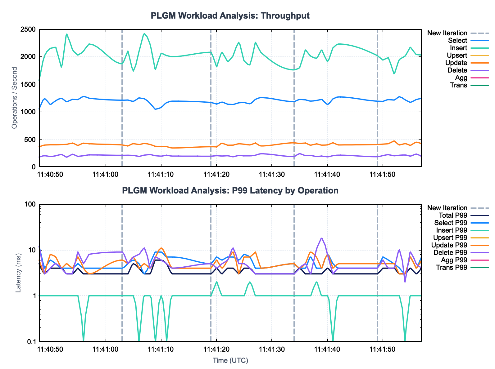
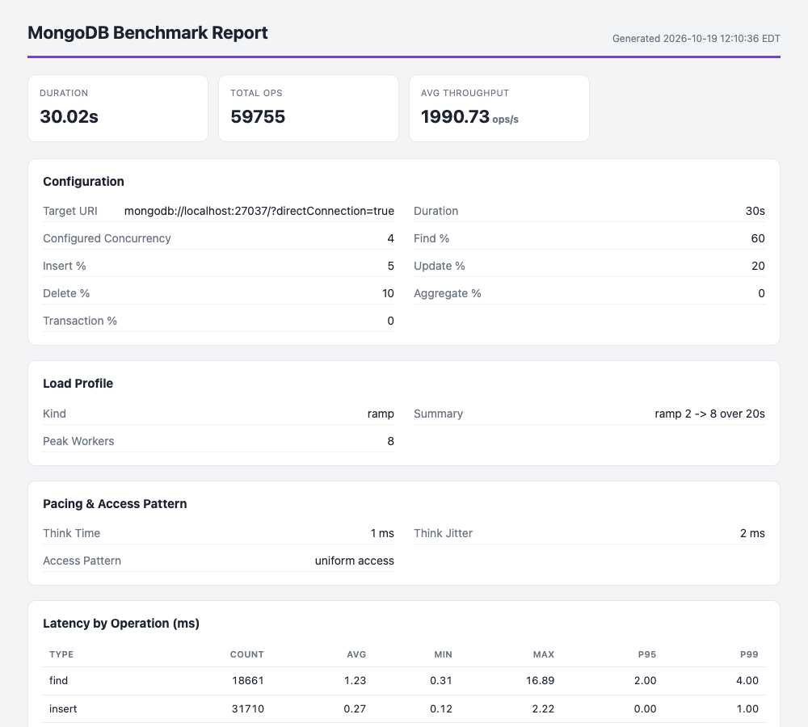

# Reports and Exports

Three ways to get results out of PLGM: a CSV file streamed during the run, a JSON summary after the run, and a self-contained HTML report you can attach to a ticket or send to a colleague.

[Back to the main README](../README.md)

- [CSV Metrics Export](#csv-metrics-export)
- [Post-Run JSON Summary Report](#post-run-json-summary-report)
- [Shareable HTML Run Reports](#shareable-html-run-reports)

---

## CSV Metrics Export

When CSV export is enabled, PLGM writes a new row to the file every time the `status_refresh_rate_sec` ticker fires. Because it flushes to disk continuously, your benchmark data is preserved even if the test is forcefully interrupted.

**In the Web UI:**

1. Open **Metrics & Insights > Export & Reporting**.
2. Turn on **Enable Real-Time CSV Metrics Export**.
3. Set **CSV Export Path & Filename**, for example `/tmp/plgm_metrics_export.csv`.
4. Optional: turn on **Append to existing file (do not overwrite)** to collect several runs in one file.
5. Click **Launch Workload**.



**In `config.yaml`:**

| Config Setting | Description | Example |
| :--- | :--- | :--- |
| `csv_export_enabled` | Continuously stream workload throughput metrics to a CSV file | `false` |
| `csv_export_append` | If true, appends to the file. If false, overwrites it. | `false` |
| `csv_export_path` | Path and metrics file name | `/tmp/plgm_metrics_export.csv` |

The CSV includes the following headers:

`Timestamp,ElapsedSec,Select_OpsSec,Insert_OpsSec,Upsert_OpsSec,Update_OpsSec,Delete_OpsSec,Agg_OpsSec,Trans_OpsSec,Total_Lat_P99,Select_Lat_P99,Insert_Lat_P99,Upsert_Lat_P99,Update_Lat_P99,Delete_Lat_P99,Agg_Lat_P99,Trans_Lat_P99,Iteration`

*Tip: Enable the **Append to existing file** option to run a series of varying workloads (e.g., ramping up concurrency from 4 to 16 to 64) and capture the entire progression in a single, unbroken CSV file for easy graphing.*

<details>
<summary>Sample output:</summary>

`cat /tmp/plgm_metrics_export.csv`

```csv
Timestamp,ElapsedSec,Select_OpsSec,Insert_OpsSec,Upsert_OpsSec,Update_OpsSec,Delete_OpsSec,Agg_OpsSec,Trans_OpsSec,Total_Lat_P99,Select_Lat_P99,Insert_Lat_P99,Upsert_Lat_P99,Update_Lat_P99,Delete_Lat_P99,Agg_Lat_P99,Trans_Lat_P99,Iteration
2026-03-25T11:40:48-04:00,1,1051.00,1570.00,0.00,363.00,177.00,0.00,0.00,5.00,12.00,1.00,0.00,6.00,12.00,0.00,0.00,1
2026-03-25T11:40:49-04:00,2,1239.00,2020.00,0.00,394.00,201.00,0.00,0.00,3.00,4.00,1.00,0.00,3.00,3.00,0.00,0.00,1
2026-03-25T11:40:50-04:00,3,1131.00,2150.00,0.00,399.00,186.00,0.00,0.00,4.00,6.00,1.00,0.00,8.00,4.00,0.00,0.00,1
2026-03-25T11:40:51-04:00,4,1200.00,2170.00,0.00,399.00,199.00,0.00,0.00,4.00,5.00,1.00,0.00,7.00,5.00,0.00,0.00,1
2026-03-25T11:40:52-04:00,5,1244.00,1810.00,0.00,403.00,223.00,0.00,0.00,4.00,4.00,1.00,0.00,4.00,4.00,0.00,0.00,1
2026-03-25T11:40:53-04:00,6,1181.00,2410.00,0.00,408.00,175.00,0.00,0.00,3.00,4.00,1.00,0.00,5.00,3.00,0.00,0.00,1
2026-03-25T11:40:54-04:00,7,1223.00,2130.00,0.00,429.00,226.00,0.00,0.00,3.00,4.00,1.00,0.00,4.00,3.00,0.00,0.00,1
2026-03-25T11:40:55-04:00,8,1220.00,2030.00,0.00,386.00,189.00,0.00,0.00,4.00,5.00,1.00,0.00,7.00,9.00,0.00,0.00,1
2026-03-25T11:40:56-04:00,9,1278.00,2100.00,0.00,428.00,201.00,0.00,0.00,3.00,4.00,0.00,0.00,4.00,5.00,0.00,0.00,1
2026-03-25T11:40:57-04:00,10,1246.00,2230.00,0.00,418.00,216.00,0.00,0.00,3.00,4.00,1.00,0.00,3.00,8.00,0.00,0.00,1
2026-03-25T11:41:03-04:00,1,1210.00,1870.00,0.00,396.00,208.00,0.00,0.00,3.00,4.00,1.00,0.00,6.00,9.00,0.00,0.00,2
2026-03-25T11:41:04-04:00,2,1212.00,2100.00,0.00,379.00,210.00,0.00,0.00,3.00,5.00,1.00,0.00,5.00,5.00,0.00,0.00,2
2026-03-25T11:41:05-04:00,3,1188.00,1740.00,0.00,420.00,206.00,0.00,0.00,5.00,6.00,1.00,0.00,7.00,7.00,0.00,0.00,2
2026-03-25T11:41:06-04:00,4,1250.00,2090.00,0.00,404.00,189.00,0.00,0.00,4.00,5.00,0.00,0.00,4.00,8.00,0.00,0.00,2
2026-03-25T11:41:07-04:00,5,1234.00,2420.00,0.00,423.00,212.00,0.00,0.00,3.00,3.00,1.00,0.00,5.00,11.00,0.00,0.00,2
2026-03-25T11:41:08-04:00,6,1154.00,2230.00,0.00,405.00,220.00,0.00,0.00,3.00,5.00,1.00,0.00,4.00,4.00,0.00,0.00,2
2026-03-25T11:41:09-04:00,7,1046.00,1770.00,0.00,372.00,200.00,0.00,0.00,6.00,9.00,0.00,0.00,7.00,7.00,0.00,0.00,2
2026-03-25T11:41:10-04:00,8,1078.00,2060.00,0.00,368.00,193.00,0.00,0.00,6.00,9.00,1.00,0.00,11.00,6.00,0.00,0.00,2
2026-03-25T11:41:11-04:00,9,1166.00,2020.00,0.00,366.00,209.00,0.00,0.00,5.00,7.00,0.00,0.00,7.00,5.00,0.00,0.00,2
2026-03-25T11:41:12-04:00,10,1192.00,2000.00,0.00,341.00,194.00,0.00,0.00,3.00,7.00,1.00,0.00,4.00,4.00,0.00,0.00,2
2026-03-25T11:41:19-04:00,1,1168.00,2080.00,0.00,364.00,192.00,0.00,0.00,3.00,5.00,1.00,0.00,4.00,5.00,0.00,0.00,3
2026-03-25T11:41:20-04:00,2,1140.00,1820.00,0.00,362.00,202.00,0.00,0.00,4.00,7.00,2.00,0.00,6.00,4.00,0.00,0.00,3
2026-03-25T11:41:21-04:00,3,1174.00,2080.00,0.00,428.00,195.00,0.00,0.00,3.00,6.00,1.00,0.00,4.00,5.00,0.00,0.00,3
2026-03-25T11:41:22-04:00,4,1137.00,1910.00,0.00,392.00,200.00,0.00,0.00,4.00,7.00,1.00,0.00,6.00,6.00,0.00,0.00,3
2026-03-25T11:41:23-04:00,5,1131.00,2020.00,0.00,393.00,181.00,0.00,0.00,4.00,7.00,1.00,0.00,9.00,11.00,0.00,0.00,3
2026-03-25T11:41:24-04:00,6,1161.00,2260.00,0.00,418.00,205.00,0.00,0.00,3.00,6.00,1.00,0.00,3.00,5.00,0.00,0.00,3
2026-03-25T11:41:25-04:00,7,1167.00,1920.00,0.00,409.00,198.00,0.00,0.00,4.00,8.00,1.00,0.00,7.00,5.00,0.00,0.00,3
2026-03-25T11:41:26-04:00,8,1143.00,1850.00,0.00,397.00,198.00,0.00,0.00,4.00,7.00,2.00,0.00,7.00,4.00,0.00,0.00,3
2026-03-25T11:41:27-04:00,9,1223.00,2260.00,0.00,431.00,210.00,0.00,0.00,3.00,4.00,1.00,0.00,9.00,3.00,0.00,0.00,3
2026-03-25T11:41:28-04:00,10,1256.00,2080.00,0.00,378.00,236.00,0.00,0.00,3.00,4.00,1.00,0.00,4.00,3.00,0.00,0.00,3
2026-03-25T11:41:34-04:00,1,1183.00,1760.00,0.00,435.00,184.00,0.00,0.00,3.00,5.00,1.00,0.00,5.00,3.00,0.00,0.00,4
2026-03-25T11:41:35-04:00,2,1222.00,1800.00,0.00,425.00,239.00,0.00,0.00,4.00,4.00,1.00,0.00,4.00,4.00,0.00,0.00,4
2026-03-25T11:41:36-04:00,3,1216.00,2120.00,0.00,430.00,203.00,0.00,0.00,3.00,4.00,1.00,0.00,5.00,5.00,0.00,0.00,4
2026-03-25T11:41:37-04:00,4,1193.00,2010.00,0.00,392.00,205.00,0.00,0.00,3.00,7.00,1.00,0.00,9.00,3.00,0.00,0.00,4
2026-03-25T11:41:38-04:00,5,1204.00,1970.00,0.00,415.00,186.00,0.00,0.00,3.00,4.00,2.00,0.00,7.00,10.00,0.00,0.00,4
2026-03-25T11:41:39-04:00,6,1222.00,2120.00,0.00,393.00,194.00,0.00,0.00,3.00,4.00,1.00,0.00,4.00,18.00,0.00,0.00,4
2026-03-25T11:41:40-04:00,7,1130.00,1910.00,0.00,398.00,180.00,0.00,0.00,4.00,8.00,1.00,0.00,8.00,8.00,0.00,0.00,4
2026-03-25T11:41:41-04:00,8,1232.00,2160.00,0.00,436.00,201.00,0.00,0.00,3.00,5.00,0.00,0.00,4.00,3.00,0.00,0.00,4
2026-03-25T11:41:42-04:00,9,1269.00,2230.00,0.00,397.00,211.00,0.00,0.00,3.00,4.00,1.00,0.00,5.00,4.00,0.00,0.00,4
2026-03-25T11:41:49-04:00,1,1192.00,2020.00,0.00,404.00,182.00,0.00,0.00,3.00,4.00,1.00,0.00,5.00,4.00,0.00,0.00,5
2026-03-25T11:41:50-04:00,2,1188.00,1940.00,0.00,411.00,203.00,0.00,0.00,4.00,7.00,1.00,0.00,5.00,6.00,0.00,0.00,5
2026-03-25T11:41:51-04:00,3,1220.00,1980.00,0.00,419.00,219.00,0.00,0.00,4.00,6.00,1.00,0.00,5.00,4.00,0.00,0.00,5
2026-03-25T11:41:52-04:00,4,1212.00,1690.00,0.00,468.00,199.00,0.00,0.00,4.00,5.00,1.00,0.00,5.00,4.00,0.00,0.00,5
2026-03-25T11:41:53-04:00,5,1272.00,1950.00,0.00,397.00,209.00,0.00,0.00,3.00,4.00,1.00,0.00,3.00,10.00,0.00,0.00,5
2026-03-25T11:41:54-04:00,6,1218.00,2010.00,0.00,420.00,214.00,0.00,0.00,3.00,3.00,0.00,0.00,3.00,2.00,0.00,0.00,5
2026-03-25T11:41:55-04:00,7,1171.00,2170.00,0.00,389.00,193.00,0.00,0.00,4.00,7.00,1.00,0.00,7.00,9.00,0.00,0.00,5
2026-03-25T11:41:56-04:00,8,1220.00,2040.00,0.00,446.00,230.00,0.00,0.00,3.00,4.00,1.00,0.00,4.00,5.00,0.00,0.00,5
2026-03-25T11:41:57-04:00,9,1244.00,2030.00,0.00,420.00,188.00,0.00,0.00,4.00,7.00,1.00,0.00,6.00,4.00,0.00,0.00,5
```
</details>

Once the csv is exported, you can script your own method to plot its data. We have provided a sample gnuplot script ([gnuplot_csv.gnu](../resources/gnuplot_csv.gnu)) so you can see how this works. All you need to do is point the script to where the csv is located:

```bash
./gnuplot_csv.gnu /tmp/plgm_metrics_export.csv
```



## Post-Run JSON Summary Report

If you forget to enable the real-time CSV export, or if you just want a clean summary of your final results, click **Download Summary** in the Web UI. The button appears the moment a workload finishes.

This generates a downloadable JSON summary report that captures the final performance metrics (total ops, average latencies, and throughput per operation type), the post-run insights analysis, and the exact configuration parameters used to achieve those results. Passwords are automatically redacted from this file for safe sharing.

Example Summary Snippet:

```json
{
    "generated_at": "2026-03-12T20:32:00.409Z",
    "duration_seconds": "10.51",
    "total_operations": 2159,
    "average_throughput_ops_sec": "205.50",
    "average_throughput_per_op": {
        "find": "59.56",
        "insert": "109.42",
        "update": "23.69",
        "delete": "12.75"
    },
    "operations": { ... },
    "average_latencies_ms": { ... },
    "insights": { ... },
    "configuration": {
        "concurrency": "4",
        "find_batch_size": "10",
        "password": "********"
    }
}
```

## Shareable HTML Run Reports

When a run finishes, click **Export HTML Report** (or open `GET /api/report`) to generate a
self-contained HTML report, with no external assets or JavaScript. It includes the
run summary, full configuration, load profile, pacing, access pattern, latency
table, an inline latency-over-time chart, notable insights and warnings, and the recording, replay, and per-target sections when Record & Replay was used. Use the
browser's Print → Save as PDF to export a PDF.
Add `?download=1` to download the HTML file directly.


