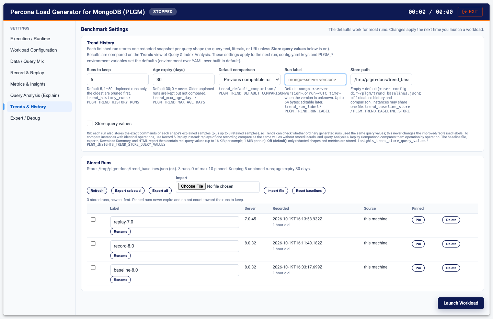
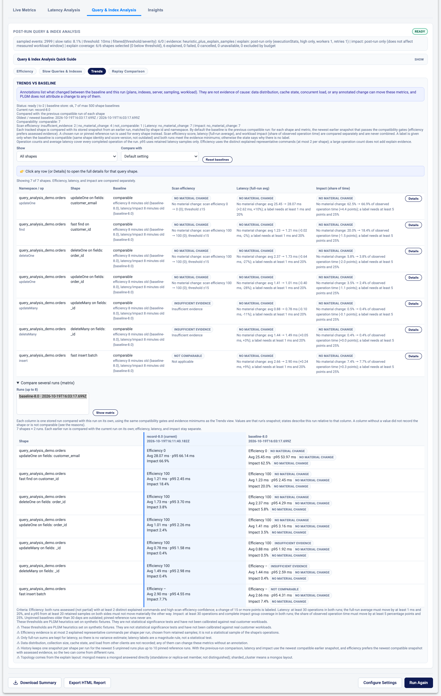

# Trends and History

PLGM keeps a short history of your runs so you can see what moved between them: a new MongoDB version, a new index, or a configuration change. Each finished run stores one redacted snapshot per query shape. You compare against the previous run, a pinned reference run, or up to eight runs side by side.

Trends need the post-run query analysis. See [Query and Index Analysis](./query-analysis.md).

[Back to the main README](../README.md)

- [Configure trend history in the Web UI](#configure-trend-history-in-the-web-ui)
- [Compare runs in the Web UI](#compare-runs-in-the-web-ui)
- [Where history is stored](#where-history-is-stored)
- [History, labels, and pinning](#history-labels-and-pinning)
- [Comparison](#comparison)
- [Sharing](#sharing)
- [Size](#size)
- [Settings reference](#settings-reference)
- [Store query values](#store-query-values)
- [Reset, delete, and migration](#reset-delete-and-migration)

---

## Configure trend history in the Web UI

1. Start the UI with `./plgm --webui` and open the **Trends & History** settings tab.
2. Under **Trend History**, set:
   - **Runs to keep**: how many unpinned runs to keep (default 5, up to 50).
   - **Age expiry (days)**: unpinned runs older than this are shown as outdated and not compared (default 30, `0` = never).
   - **Default comparison**: **Previous compatible run** (default) or **Newest pinned reference run**.
   - **Run label**: a name for the runs you start with these settings, for example `7.0-baseline`. Leave empty to use `mongo-<server version>`.
   - **Store path**: leave empty for the default location, enter a file path to use another file, or `off` to turn history off.
   - **Store query values**: leave off unless you need to check whether two runs used the same values. See [Store query values](#store-query-values).
3. Make sure **Query Analysis (Explain) > Enable Post-Run Explain Sampling** is on (the default).
4. Click **Launch Workload**. When the run finishes, it is added to the history.



### Manage stored runs

The **Stored Runs** list on the same tab shows every run with its label, server version, age, and source.

- **Rename** a run: edit the label and click **Rename**.
- **Pin** a run you want to keep as a reference, for example "7.0 baseline" or "before the new index". Pinned runs never get cleaned up. You can pin up to 10.
- **Delete** a run: click **Delete**, then **Confirm delete**.
- **Export**: tick the runs and click **Export selected**, or click **Export all**. You get a JSON file you can send to a colleague.
- **Import**: choose a file next to **Import** and click **Import file**.
- **Refresh** reloads the list. **Reset baselines** clears all runs.

## Compare runs in the Web UI

1. After a run, open **Query & Index Analysis > Trends** on the dashboard.
2. Use **Compare with** to choose the baseline: the previous compatible run, the newest pinned run, or any stored run.
3. Use **Show** to filter the rows by verdict (improved, regressed, not comparable, and so on).
4. Click a shape to open its detail dialog.
5. To compare several runs at once, open **Compare several runs (matrix)**, select up to 8 runs in **Runs (up to 8)**, and click **Show matrix**. Each column is one run, with average latency, p95, efficiency score, and impact share; the current run is highlighted.

If a pair of runs cannot be compared (too few operations, partial explain output, a changed plan or server version), the cell says why instead of showing a verdict.

The screenshot shows run `record-8.0` compared with `baseline-8.0`, two runs of the same demo workload, with the matrix open below the table:



## Where history is stored

Post-run trend history (the **Trends** view under Query & Index Analysis) is stored in a local JSON file, `trend_baselines.json`, in the user config directory, next to `definitions.json`:

```bash
~/.config/plgm/trend_baselines.json                         # Linux
~/Library/Application Support/plgm/trend_baselines.json     # macOS
```

Each finished run adds one snapshot per query shape, newest first. A snapshot holds bounded, redacted summaries only (scores, counts, latencies, plan stage names, index names, server version, and sampling/workload settings), never query text, literals, or the connection URI (literal query values are kept only when **Store query values** is on; see below). Override or disable it in the UI (**Store path**), with `trend_baseline_store` in `config.yaml`, or with:

```bash
export PLGM_TREND_BASELINE_STORE=/path/to/plgm-trend-baselines.json
export PLGM_TREND_BASELINE_STORE=off   # no history and no trend comparison
```

## History, labels, and pinning

The store keeps the newest `trend_history_runs` unpinned runs (default 5); older runs and their snapshots are pruned. Every run has a label: `trend_run_label` if set, otherwise `mongo-<server version>`, or `run-<UTC time>` when the version is unknown. Rename a run later in **Trends & History**. Pin a run to keep it as a reference: pinned runs (at most 10) do not count toward `trend_history_runs`, are never pruned, and never expire. Unpinned runs older than `trend_max_age_days` (default 30; `0` = never) stay stored but are reported as `outdated` instead of compared.

## Comparison

By default each shape is compared with the previous compatible run: for each metric, the newest earlier snapshot that passes the compatibility gates. The Trends view can instead compare every shape with a chosen run or with the newest pinned run, or show a matrix of the current run and up to 8 stored runs (one column per run with average and p95 latency, efficiency score, and impact share, the current run highlighted). Each pair is gated separately; when a pair is not comparable, the cell shows the reason. Efficiency, latency, and impact are never combined. The same views are available from `GET /api/trends/compare?baseline=previous|pinned|<run id>` or `GET /api/trends/compare?runs=<id>,<id>` (matrix); both use the last finished run.

Trends compare shapes across runs heuristically; they cannot tell whether two runs sent the same operations. For an exact A-vs-B comparison, use [Record and Replay](./record-and-replay.md).

## Sharing

Export selected runs (or all) from **Trends & History**, or with `GET /api/trend-baselines/export?runs=<id>,<id>&source=<label>`. Import a file in the same tab (or `POST /api/trend-baselines/import`, multipart field `file` or a raw JSON body). Imports must use the current schema (`tb-2`) and stay within the limits (32 MiB, 64 runs, 500 shapes). Runs are merged by `run_id`: duplicates are skipped, and the result lists what was added, skipped, or not kept (pruned by `trend_history_runs`). Imported runs show their source label. Only the redacted trend fields are read; anything else in the file is ignored and reported. Run ids combine a UTC timestamp, a run counter, and 64 random bits, so they stay unique across machines.

Several instances can share one store file (for example on a shared volume). Every write takes a lock file (`<store>.lock`), re-reads the file, merges its change, and replaces the file atomically. A lock older than 30 seconds is treated as stale.

## Size

Snapshots average about 0.75 KB per shape per run, so a full 500-shape store with 5 runs is about 2 MB, and the maximum of 60 runs (50 unpinned plus 10 pinned) is about 23 MB. Every text field is bounded, so the theoretical worst case would be larger. A hard cap keeps the file at most 32 MiB: past it, the oldest unpinned runs are dropped first (never the newest run or a pinned run), then the least recently seen shapes.

## Settings reference

| Setting | config.yaml | Environment | Default | UI (Trends & History) |
|---|---|---|---|---|
| Runs to keep (unpinned) | `trend_history_runs` | `PLGM_TREND_HISTORY_RUNS` | `5` (1–50) | Runs to keep |
| Age expiry in days | `trend_max_age_days` | `PLGM_TREND_MAX_AGE_DAYS` | `30` (`0` = never, max 3650) | Age expiry (days) |
| Store path | `trend_baseline_store` | `PLGM_TREND_BASELINE_STORE` | user config dir; `off` disables | Store path |
| Default comparison | `trend_default_comparison` | `PLGM_TREND_DEFAULT_COMPARISON` | `previous` (or `pinned`) | Default comparison |
| Run label | `trend_run_label` | `PLGM_TREND_RUN_LABEL` | `mongo-<version>` / `run-<time>` | Run label |
| Store query values | `insights_trend_store_query_values` | `PLGM_INSIGHTS_TREND_STORE_QUERY_VALUES` | `false` | Store query values |

Precedence is environment over config.yaml over the default. Values set in the UI apply to the run they start. Non-numeric or negative numeric environment values (and a run count of 0) are ignored. Out-of-range YAML values are clamped to the maximum or replaced with the default, and an unknown comparison mode means `previous`. The UI rejects out-of-range values before the run starts.

## Store query values

On: each run also stores the exact commands of each shape's explained samples (plus up to 8 retained samples), so Trends can show whether two runs used the same query values; this never changes the improved/regressed labels. The baseline file, exports, Download Summary, and HTML report then contain real query values (up to 16 KiB per sample, 1 MiB per run). Off (default): only redacted shapes and metrics are stored, as described above.

Runs replayed from the same recording, or generated with the same deterministic fingerprint, compare as "same values" without storing any literals. See [Record and Replay](./record-and-replay.md).

## Reset, delete, and migration

Use **Reset baselines** (Trends view or Trends & History, or `DELETE /api/trend-baselines`) to clear all runs; `DELETE /api/trend-baselines/runs/<id>` removes one, and `PATCH` with `{"label": "...", "pinned": true}` renames or pins it. A `tb-1` file from an earlier version is migrated on load: each stored snapshot becomes the first history entry, and the file is rewritten as `tb-2` on the next save. An unreadable or unsupported file is moved aside (renamed with a `.corrupt-` or `.unsupported-` suffix), never deleted.
