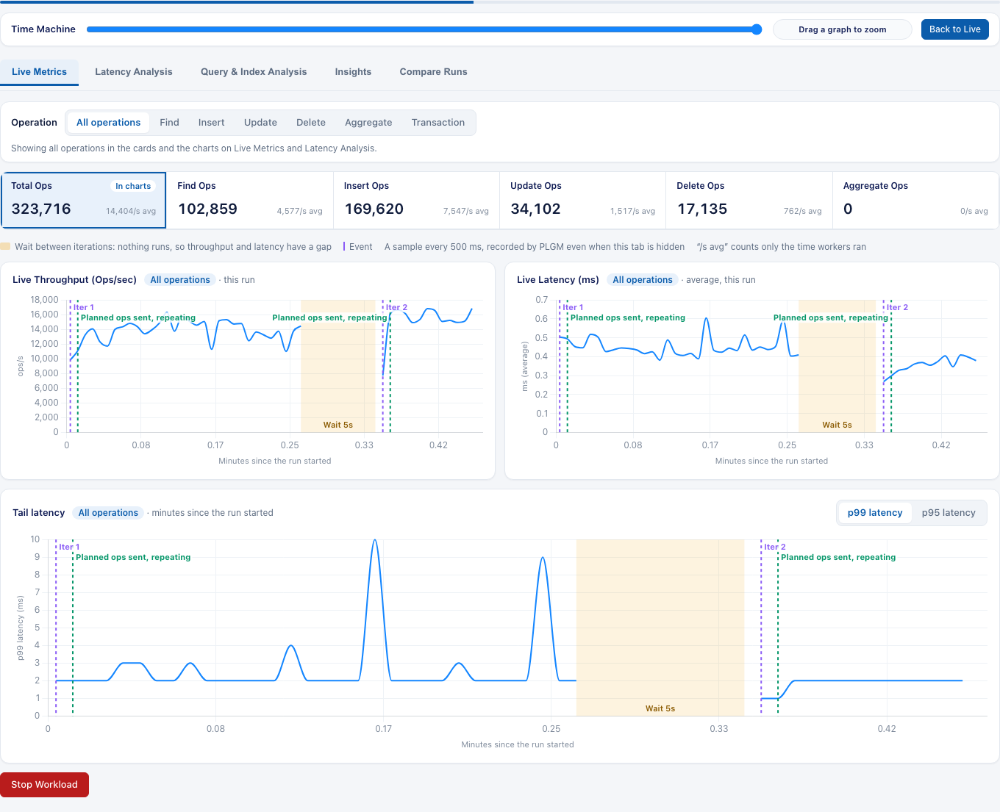
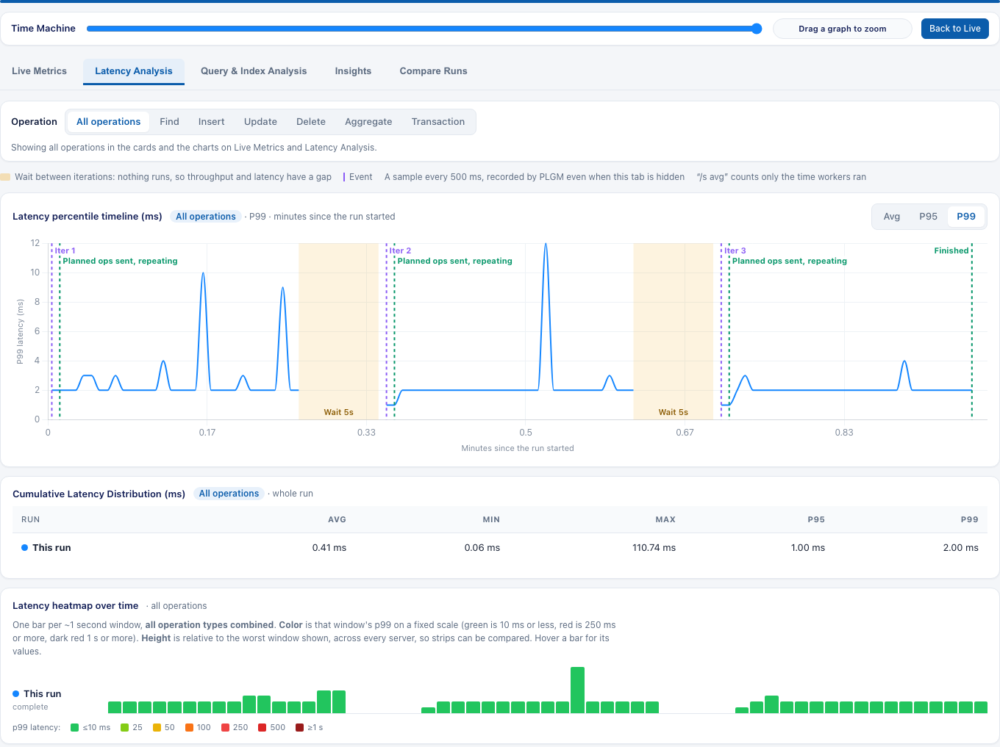
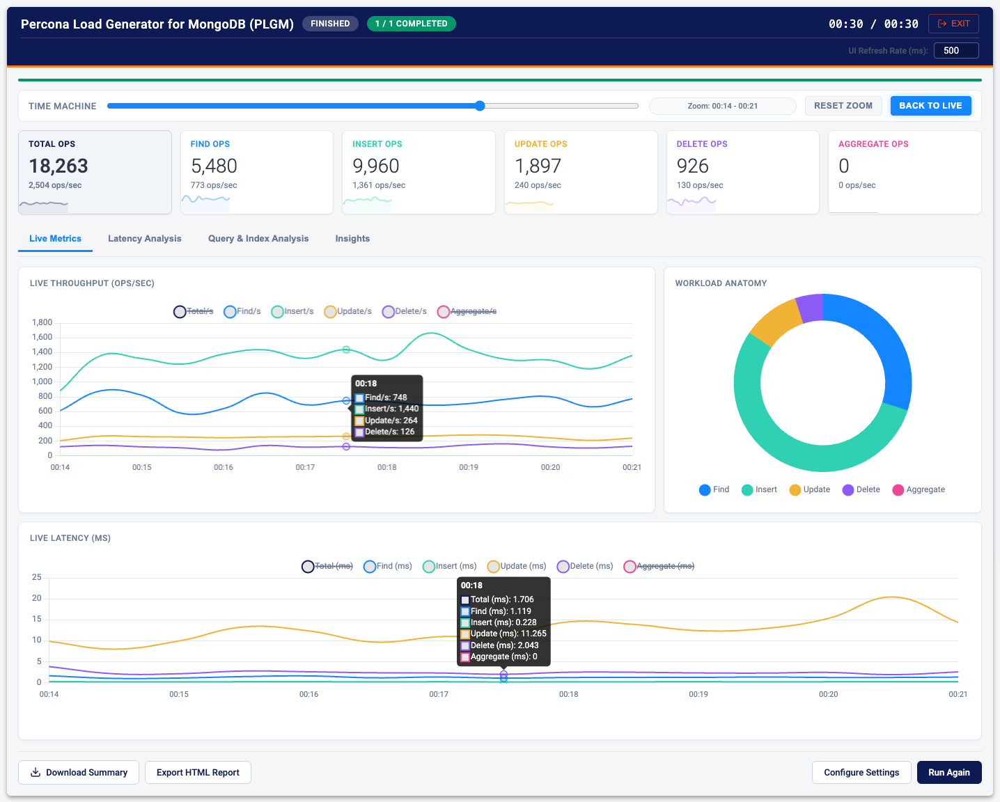

# Web UI

PLGM ships with an embedded Web UI. You choose what kind of run you want, fill in the settings that apply, and watch throughput and latency live, without editing a YAML file. It has the same functionality as the CLI. Longer explanations sit behind a **?** help button placed right after the setting's label (or the section heading). The button's name starts with "Help:" followed by the setting name. Hover, keyboard focus, or a click or tap opens it; Escape or a click outside closes it. Required fields, validation errors, and warnings that change what the run will do stay on the page.

[Back to the main README](../README.md) · UI conventions for contributors: [Web UI design system](./web-ui-design-system.md)

- [Starting the UI](#starting-the-ui)
- [Accessing the UI on a remote host](#accessing-the-ui-on-a-remote-host-recommended-ssh-tunnel)
- [Your first run](#your-first-run)
- [Settings categories](#settings-categories)
- [The Observability Dashboard](#the-observability-dashboard)
- [The "Time Machine" Scrubber and Drag-to-Zoom](#the-time-machine-scrubber-and-drag-to-zoom)
- [Workload Lifecycle & Timing Semantics](#workload-lifecycle--timing-semantics)
- [Shutting down](#shutting-down)

---

## Starting the UI

Pass the `--webui` flag. PLGM starts a local server bound to the loopback interface (`127.0.0.1`) and opens your default browser on port 9999. You can set a custom port:

```bash
./bin/plgm --webui
# Or, set a custom port:
./bin/plgm --webui --webui-port=32000
```

### HTTP vs. HTTPS (no certificate warnings)

By default the UI is served over plain **HTTP bound to loopback** (`http://127.0.0.1:<port>/`). Because the server never listens on a public interface, traffic stays on your machine, and browsers treat `http://localhost`/`http://127.0.0.1` as a *secure context*, so you get **no "your connection is not private" / `ERR_CERT_AUTHORITY_INVALID` warnings**.

Enable HTTPS only if you intend to expose the UI beyond loopback. For a **warning-free** HTTPS endpoint, supply a certificate/key that your clients already trust:

```bash
./bin/plgm --webui --webui-cert=/path/to/tls.crt --webui-key=/path/to/tls.key
```

If you enable TLS without providing a certificate (`--webui-tls` alone), PLGM falls back to a temporary self-signed certificate. Browsers will warn until it is trusted, so this is not recommended for day-to-day use.

Equivalent `config.yaml` (`web_ui.tls_enabled`, `web_ui.tls_cert_file`, `web_ui.tls_key_file`) and environment variables (`PLGM_WEBUI_TLS`, `PLGM_WEBUI_TLS_CERT`, `PLGM_WEBUI_TLS_KEY`) are also available.

| Config Setting | Environment Variable | Description | Example |
| :--- | :--- | :--- | :--- |
| `enabled` | `PLGM_WEBUI_ENABLED` | Force launch the Web UI | `true` |
| `port` | `PLGM_WEBUI_PORT` | Port for the Web UI | `9999` |
| `tls_enabled` | `PLGM_WEBUI_TLS` | Serve the Web UI over HTTPS (default HTTP on loopback, no cert warnings) | `false` |
| `tls_cert_file` | `PLGM_WEBUI_TLS_CERT` | TLS certificate file for the Web UI (for warning-free HTTPS) | `/etc/ssl/plgm.crt` |
| `tls_key_file` | `PLGM_WEBUI_TLS_KEY` | TLS private key file for the Web UI | `/etc/ssl/plgm.key` |

## Accessing the UI on a remote host (recommended: SSH tunnel)

When PLGM runs on a remote server (for example, in your lab or cluster), the **recommended and secure** way to reach the UI is an SSH local port-forward. Run PLGM normally on the remote host (default HTTP on loopback, no TLS needed), then from your workstation:

```bash
# Forward local port 9999 to 127.0.0.1:9999 on the remote host
ssh -L 9999:127.0.0.1:9999 youruser@remote-host
```

Then open `http://localhost:9999` in your local browser.

**This is safe and introduces no network vulnerability.** With this setup, the only unencrypted segments are the loopback interfaces on each end, which are never exposed to the network:

```
[your browser] --http--> localhost:9999 (your machine's loopback)
                              │
                              │  encrypted by SSH  ← the only network hop
                              ▼
   [sshd on remote] --http--> 127.0.0.1:9999 (remote loopback; PLGM listens here)
```

- SSH encrypts the entire network path between your workstation and the remote host. That is the only segment an attacker on the network could observe, and it is fully protected.
- PLGM binds only to `127.0.0.1` on the remote host, and `ssh -L` binds only to your workstation's loopback, so the UI is never reachable from the network on either end.

Because SSH already provides the encryption, **you do not need to enable HTTPS/TLS for this workflow**. Doing so would be redundant and would bring back browser certificate warnings. Enabling TLS is only useful if you expose PLGM directly on a network interface without an SSH tunnel.

## Your first run

1. Choose a task under **What do you want to do?** Each card names the task and says in one sentence what it does; the whole card is the button, and the arrow keys move between cards. **Open completed runs** (the sixth tile, also **Completed Runs** in the header) reopens stored dashboards instead of starting a run. After you pick a task the cards shrink to a compact switcher above its settings. The cards are the only mode control. Only the settings for that mode are shown. Selecting another card before launch keeps values that still apply (URI, worker count, duration, file paths) and leaves the others on the form, but a hidden setting is not sent as part of the run. While a workload is running, the cards stay locked. `operation_mode` is a form field, not a `config.yaml` key. A request that omits it keeps the previous behavior and applies every submitted field. `record_workload_source` is UI-only: it chooses the built-in workload or your definitions while recording.
2. Fill in the basic fields. **MongoDB URI** is required for a database workload. Workers, duration, and seed size already have defaults. **Settings level** shows **Basic** settings; turn on **Advanced** and/or **Expert** to add those sections (each is marked with its level). Values you change keep applying when a level is collapsed again. The summary in the launch bar at the bottom of the form is the configuration that will run.
3. Click **Launch Workload**. The server applies the same mode rules as the form, so a leftover replay or record flag cannot change a generic run.
4. Watch the dashboard. Click **Stop Workload** to end the run early.
5. When the run finishes, review **Query & Index Analysis**, then click **Download Summary** or **Export HTML Report**.

| Mode | What you set first | What stays out of the way |
| :--- | :--- | :--- |
| **Run a generic workload** | URI, workers, duration, seed size, operation mix. Built-in collections and queries are used. | Custom definition files, record, replay, and the raw injector. |
| **Run a custom workload** | The same basics, plus a collection definition and a query definition from the library. | Record, replay, and the raw injector. |
| **Record a workload** | URI, workers, duration, and either the built-in workload or your definitions. The recording path defaults to `plgm_workload_record.ndjson`. | Replay and the raw injector. |
| **Replay a recorded workload** | The recording file or server path, and the definitions that match that recording. | Record, deterministic traffic, the operation mix, and the raw injector. |
| **Stress test** | Raw injector type, document size, and batch size. | Query definitions, record, replay, and deterministic traffic. |

**Advanced** holds pacing, seeding options, deterministic traffic, multi-target, outcomes, schema inference, insights, explain, and trend retention. **Expert** holds TLS, the connection pool, batch sizes, sharding, explain limits, CSV export, and debug options. Open **Advanced** or **Expert** to change them. Those values are included when the mode can use them.

Passwords stay in the browser session and are not written into a completed-run file.

## Completed runs

**Completed Runs** is in the header. It lists each finished run with its name, start time, duration, mode, status, and a short throughput and latency summary when those were stored. **Open dashboard** shows that run's saved charts, latency, and configuration. It does not start a workload, and it does not need the database to still be reachable. **HTML report** downloads the stored report. **Pin** keeps a run when older ones are pruned. Opening a saved dashboard is blocked while a workload is still running.

A measurement that was not stored is shown as unavailable or "—". It is not shown as zero. A damaged or unrecognized file is listed with an error and can be removed from the dashboard directory; the other runs still open.

Closing the browser, stopping PLGM, and starting it again with the same storage brings the list back. See [Trends and History](./trends-and-history.md#completed-run-dashboards) for the directory, retention, and the volume a container needs. Trend baselines on **Trends & History** are a separate store: per-shape comparisons, not the dashboard.


This walkthrough runs the bundled `query_analysis_demo` workload, which mixes index-backed queries with deliberately unindexed ones, against a local MongoDB:

1. **Configure:** set the connection, workload shape, query mix, and the insights, explain, and trend settings, then upload the demo collection and query definitions.
2. **Run:** seed 100,000 documents and run for 60 seconds while the Live Metrics and Latency Analysis dashboards update, including the latency percentile timeline, cumulative distribution, and heatmap.
3. **Analyze:** after the run, PLGM samples explain plans and opens the Query & Index Analysis views: per-shape efficiency, slow queries and index issues with a detail drawer (summary, execution plan, recommendation, diagnostics, query reference), and trends compared with a previous run. The Insights overview, per-iteration, and timeline views follow.

https://github.com/user-attachments/assets/f133fd5a-baf8-4d6f-89e1-c179b83c4bef

## Settings categories

At **Basic**, the selected mode's basic settings are shown on one page. Turning on **Advanced** or **Expert** adds a **Categories** list beside the settings (a wrapped row of categories on narrow screens). **Basic settings** is always the first category; the others hold only the settings the open levels add, grouped by what they control. Only the selected category is shown. Opening a level moves to the first category it adds; a category with nothing to show for the mode and levels is not listed, and if the selected one disappears, **Basic settings** is selected. Switching categories, levels, or modes never changes a value. Arrow keys, Home, and End move through the list.

| Category | Settings it adds (level) | Modes | Guide |
| :--- | :--- | :--- | :--- |
| **Basic settings** | Connection, workers, duration, load profile, recording or replay file, definitions, seeding, operation mix, raw injector (Basic); auth source, replica set, read preference, iterations, transaction options (Advanced, kept in their Basic section) | All | [Workloads](./workloads.md) |
| **Connection** | TLS client files, connection pool, direct connection, driver debug logs (Expert) | All | [Performance Tuning](./performance-tuning.md) |
| **Workload execution** | Think time and access pattern (Advanced); batch sizes, seeding concurrency, op timeout, sharding strategy, retry controls (Expert) | Retry controls in all; sharding also in replay; the rest in generic, custom, record | [Load Modeling](./load-modeling.md), [Performance Tuning](./performance-tuning.md) |
| **Record & replay** | Random seed and deterministic traffic, multi-target, outcomes, traffic import (Advanced) | Seed: generic, custom, record; import: replay | [Record and Replay](./record-and-replay.md) |
| **Data & queries** | Schema inference from query logs (Advanced) | Custom, record | [Workloads](./workloads.md) |
| **Metrics & reporting** | Post-run insights capture (Advanced); CSV export (Expert) | Insights: all but stress test | [Reports and Exports](./reports-and-exports.md) |
| **Query analysis** | Post-run explain (Advanced); which shapes are explained, explain limits, latency targets (Expert) | All but stress test | [Query and Index Analysis](./query-analysis.md) |
| **Trends & history** | Trend retention, run label, store path, stored runs, export and import (Advanced) | Stored runs: all; the rest all but stress test | [Trends and History](./trends-and-history.md) |

The guides write a setting's place as **Category > Section** and name the level that adds it, for example **Connection > TLS Client Settings** (Expert).

Settings that depend on another category link to it: for example, **Post-Run Explain** says when it needs **Post-Run Insights** on and links to it, and deterministic traffic links to the Basic settings it switches.

**Launch Workload** validates every setting the mode uses, including ones in closed levels and other categories. Each problem is shown under its field, each category that holds one gets a red dot, and the levels that hold problems open. The first problem's category is selected and its field is focused. Fixing a field removes its message and, when it was the last one, its category's dot. If the problem is in a section the selected task does not use (for example a trend setting during a stress test), that section is shown with a note until the next launch or task change, because its value is still checked.

## The Observability Dashboard

Once the workload begins, the UI switches to a real-time dashboard with four tabs: **Live Metrics**, **Latency Analysis**, **Query & Index Analysis**, and **Insights**.





* **Live Telemetry:** throughput (Ops/sec) and average latency (ms) stream in real time for each operation type.
* **Workload Anatomy:** a live donut chart shows that the database is executing the operation ratios you configured.
* **Crosshair Sync:** hovering over a spike on the Throughput chart highlights the same moment on the Latency chart.
* **Drag-to-Zoom:** click and drag across the Throughput, Latency, or Latency Percentile Timeline charts to isolate a time range. All dashboard graphs and summary values update to that window.
* **Latency Analysis:** percentile timeline, cumulative distribution, and the [latency heatmap](./load-modeling.md#latency-heatmap-over-time).
* **Record & Replay runs:** cards for the traffic fingerprint and per-target status, progress, lag, and starting-data check.
* **After the run:** [Query & Index Analysis](./query-analysis.md#read-the-results), **Insights**, **Download Summary**, and **Export HTML Report** ([Reports and Exports](./reports-and-exports.md)).

## The "Time Machine" Scrubber and Drag-to-Zoom

If you are running a long benchmark, you might miss a sudden latency spike. The UI keeps a running history buffer of the benchmark data.

Use the **Time Machine** slider above the charts to pause the live feed and scrub backward to a specific second. All line charts, sparklines, and numeric values synchronize to show the state of the database at that point in time.

To investigate a wider window, click and drag across any main time-series chart. PLGM zooms all dashboard charts to the selected range, including throughput, average latency, latency percentiles, sparklines, numeric totals, and workload distribution. This makes it easier to isolate a latency spike, throughput drop, or short workload burst without waiting for the run to finish.

Click **Reset Zoom** to return to the normal chart window. Click **Back to Live** to clear any historical view and resume real-time monitoring. Moving the Time Machine slider also clears the current zoom selection, because the slider is used for point-in-time inspection.



## Workload Lifecycle & Timing Semantics

PLGM shows an explicit lifecycle so you can tell preparation apart from measured workload execution:

* `initializing`: collection setup, index creation, sharding/runtime preparation, optional seeding
* `running`: actual query workload execution
* `completed` / `failed`: terminal states

Important timing behavior:

* Initialization time is tracked separately and is **not** treated as execution runtime
* During initialization, the header clock counts preparation time and is labeled `init`. The progress bar follows the current setup step
* The execution timer and progress bar start when the workload itself starts. Preparation time is not included in that clock
* With more than one iteration and an interval delay, the total on the clock includes the pauses between runs. Five runs of 30s with 10s between them is 03:10 (02:30 of workload plus four 10s pauses; there is no pause after the last run). A short note under the clock states that once execution starts. It stays hidden during initialization, while the clock is counting preparation time. See [Workload Iterations](./performance-tuning.md#workload-iterations--scheduling)
* With deterministic traffic, Duration is the length of the measured run. Operations per Worker is one pass. When a worker finishes that pass, it continues the same workload until Duration ends. The header stays on the duration clock (`00:04 / 00:30`). **FINISHED** means the run filled that time; the note gives operations sent and the size of one pass. **INCOMPLETE** means Duration ended before every worker finished one pass. The traffic fingerprint is that first pass, so two runs can share it and still send different totals. See [Deterministic Generated Traffic](./record-and-replay.md#deterministic-generated-traffic)
* During initialization, the UI shows progress context (step name, progress %, and recent activity events). Seeding progress advances as documents are inserted, including inside one large collection
* Reloading the page during a run returns to that run and restores the live charts from samples kept for it, then continues. Starting again while one is already going opens the run in progress

Current limitation:

* Index creation and sharding progress are still per collection, not per index or shard
* Chart samples kept for a reload are capped at 3,600 points (about 30 minutes at the default 500ms refresh)

## Shutting down

Click **EXIT** in the header, then **Shut Down Backend**, to stop PLGM from the browser. Background workers are cleaned up, and converted traffic files are deleted.
