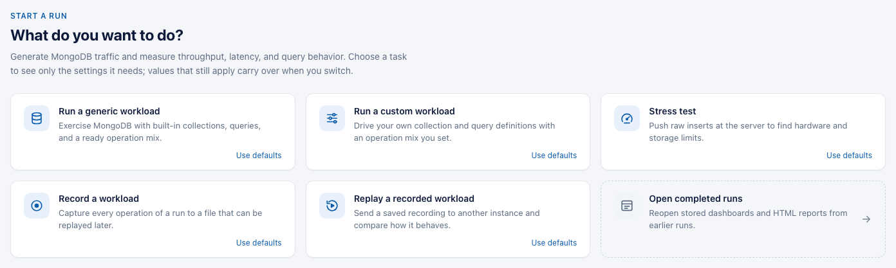
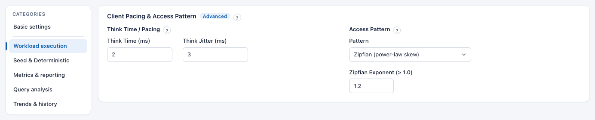
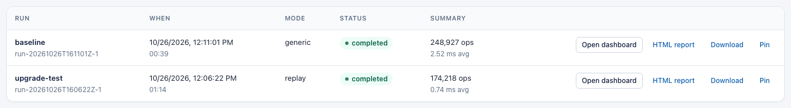

# Web UI

The Web UI does everything the CLI does. You pick a task, fill in a few fields, and watch throughput and latency while the run goes. A **?** next to a setting opens a short explanation.

[Back to the main README](../README.md) · UI conventions for contributors: [Web UI design system](./web-ui-design-system.md)

- [Start the UI](#start-the-ui)
- [Your first run](#your-first-run)
- [Settings levels and categories](#settings-levels-and-categories)
- [Dashboard](#dashboard)
- [Time Machine and zoom](#time-machine-and-zoom)
- [Completed runs](#completed-runs)
- [How the run clock works](#how-the-run-clock-works)
- [HTTPS and remote access](#https-and-remote-access)
- [Shutting down](#shutting-down)

---

## Start the UI

```bash
./bin/plgm --webui
# or on another port
./bin/plgm --webui --webui-port=32000
```

PLGM listens on `127.0.0.1:9999` and opens your browser.

[Watch a 90-second walkthrough](../images/plgm_walkthrough.mp4): record a workload, replay it on three servers, and open the comparison.

## Your first run

1. Pick a task.

   

   | Task | Use it to |
   | :--- | :--- |
   | **Run a generic workload** | Load test with the built-in collections and queries. |
   | **Run a custom workload** | Load test with your own collection and query definitions. |
   | **Stress test** | Push raw inserts to find hardware limits ([Raw Injector](./raw-injector.md)). |
   | **Record a workload** | Save every operation to a file you can replay later. |
   | **Replay a recorded workload** | Send a saved recording to one or more servers and compare them. |
   | **Open completed runs** | Reopen the dashboard or report of an earlier run. |

2. Enter the **MongoDB URI**. Workers, duration, and seed size have defaults.
3. Check the bar at the bottom. It shows what will run, for example `Generic workload · mongodb://db1:27017 · 16 workers · 60s · 100000 seed documents`.
4. Click **Launch Workload**.
5. Watch the dashboard. **Stop Workload** ends the run early.
6. When it finishes, open **Query & Index Analysis**, or click **Download Summary** or **Export HTML Report**.

**Clicking a card picks up where the last run left off.** The form starts from the last run's settings (or from `config.yaml` right after PLGM starts), so a ramp, seed, or mix you set before is still there. To start clean, click **Use defaults** on the card instead. It loads the settings PLGM started with (`config.yaml` and environment), selects the built-in definitions, and keeps your URI and credentials. Once a task is open, **Reset to defaults** under its title does the same for that task.

You can switch tasks before launching. Values that still apply (URI, workers, duration) are kept. Settings the new task doesn't use are hidden and not sent. The task cards and both defaults buttons are locked while a run is going.

If you leave the username and password empty, PLGM asks once before launching. Click **Continue** if your server has no authentication. Passwords stay in the browser session and are never saved with a run.

## Settings levels and categories

**Basic** shows what most runs need. Turn on **Advanced** or **Expert** to add more. Each added section has a small level tag. A value you change still applies if you turn the level off again.

With Advanced or Expert on, a **Categories** list appears on the left. Click a category to see its settings.



| Category | What's in it |
| :--- | :--- |
| **Basic settings** | Connection (one server or several), workers, duration, load profile, recording or replay file, definitions, seeding, operation mix |
| **Connection** | TLS files, connection pool, direct connection, driver debug logs (Expert) |
| **Workload execution** | Think time and access pattern (Advanced); batch sizes, timeouts, sharding, retries (Expert) |
| **Seed & Deterministic** | Deterministic traffic, random seed, operations per worker, and, for a deterministic generic or custom run, the servers to run on; outcome files (Advanced). Called **Outcomes & import** in a replay: outcome files and traffic import |
| **Data & queries** | Schema inference from query logs (Advanced) |
| **Metrics & reporting** | Post-run insights (Advanced); CSV export (Expert) |
| **Query analysis** | Post-run explain (Advanced); which queries are explained, limits, latency targets (Expert) |
| **Trends & history** | Run history, run label, stored runs (Advanced) |

The guides name a setting as **Category > Section**, for example **Connection > TLS Client Settings** (Expert).

**If Launch finds a problem**, the message appears under the field, the category gets a red dot, and the first bad field is selected for you. Fix it and launch again. Some settings depend on others. Their note links to the setting you need, and some turn it on for you (listing replay targets turns on Record Outcomes, for example).

## Dashboard

The dashboard has four tabs: **Live Metrics**, **Latency Analysis**, **Query & Index Analysis**, and **Insights**.


How to read **Live Metrics**:

- The tiles at the top are totals and the current rate for each operation type.
- **Live Throughput** is operations per second per type. **Live Latency** is the average latency per type.
- **Workload Anatomy** shows the operation mix actually sent. It should match the mix you set.
- The dashed lines mark when an iteration and the measured run started.


How to read **Latency Analysis**:

- **Latency percentile timeline**: pick Avg, P95, or P99 and the operation types to plot.
- **Cumulative Latency Distribution**: avg, min, max, p95, and p99 for the whole run, per operation type.
- **Latency heatmap**: one bar per second. Height is that second's p99 compared with the run's worst second. Color is the actual p99: green is 10 ms or less, red is 250 ms or more. See [Load Modeling](./load-modeling.md#latency-heatmap-over-time).

The other tabs are covered in [Query and Index Analysis](./query-analysis.md#read-the-results). Replay runs also show a table with one row per target; see [Record and Replay](./record-and-replay.md#multi-target-replay).

## Time Machine and zoom

- Drag the **Time Machine** slider to go back to any second of the run. Every chart, tile, and sparkline shows that moment.
- Drag across a chart to zoom into a time range. Everything on the page shows that range only.
- **Reset Zoom** goes back to the normal window. **Back to Live** returns to the live feed.


## Completed runs

Click **Completed Runs** in the header (or the **Open completed runs** card).



- **Open dashboard** shows the saved charts, latency, and settings of that run. The database doesn't need to be reachable.
- **HTML report** opens the run report in a new browser tab. **Download** saves it.
- **Pin** keeps the run when older runs are removed.

A value that wasn't stored shows as "—", never as zero. Runs survive a restart of PLGM; see [Trends and History](./trends-and-history.md#completed-run-dashboards) for where they're stored and how many are kept.

## How the run clock works

- First PLGM prepares: it creates collections and indexes, sets up sharding, and seeds data. The header shows `init` and the step it's on.
- The run clock starts when the workload starts. Preparation isn't counted; the note under the clock says how long it took.
- With several iterations and a pause between them, the total includes the pauses. Five 30 s runs with 10 s between them is 03:10.
- With deterministic traffic, see [Deterministic Generated Traffic](./record-and-replay.md#deterministic-generated-traffic) for what **FINISHED** and **INCOMPLETE** mean.
- Reloading the page during a run takes you back to it. Up to 3,600 chart points (about 30 minutes at the default 500 ms refresh) are restored.

## HTTPS and remote access

**On your own machine**, keep the default. Plain HTTP on `127.0.0.1` never leaves your machine, and browsers don't show certificate warnings for it.

**On a remote server**, use an SSH tunnel and keep the default on the server:

```bash
ssh -L 9999:127.0.0.1:9999 youruser@remote-host
```

Then open `http://localhost:9999`. SSH encrypts the only network hop, and PLGM can't be reached from the network on either end, so you don't need HTTPS.

**Only if you expose PLGM on a network interface**, turn on HTTPS with a certificate your browsers trust:

```bash
./bin/plgm --webui --webui-cert=/path/to/tls.crt --webui-key=/path/to/tls.key
```

`--webui-tls` without a certificate uses a temporary self-signed one, and browsers will warn.

| Config Setting | Environment Variable | Description | Example |
| :--- | :--- | :--- | :--- |
| `web_ui.enabled` | `PLGM_WEBUI_ENABLED` | Start the Web UI | `true` |
| `web_ui.port` | `PLGM_WEBUI_PORT` | Port | `9999` |
| `web_ui.tls_enabled` | `PLGM_WEBUI_TLS` | Serve over HTTPS | `false` |
| `web_ui.tls_cert_file` | `PLGM_WEBUI_TLS_CERT` | TLS certificate file | `/etc/ssl/plgm.crt` |
| `web_ui.tls_key_file` | `PLGM_WEBUI_TLS_KEY` | TLS private key file | `/etc/ssl/plgm.key` |

## Shutting down

Click **Exit** in the header, then **Shut Down Backend**. PLGM stops its workers and deletes converted traffic files.
