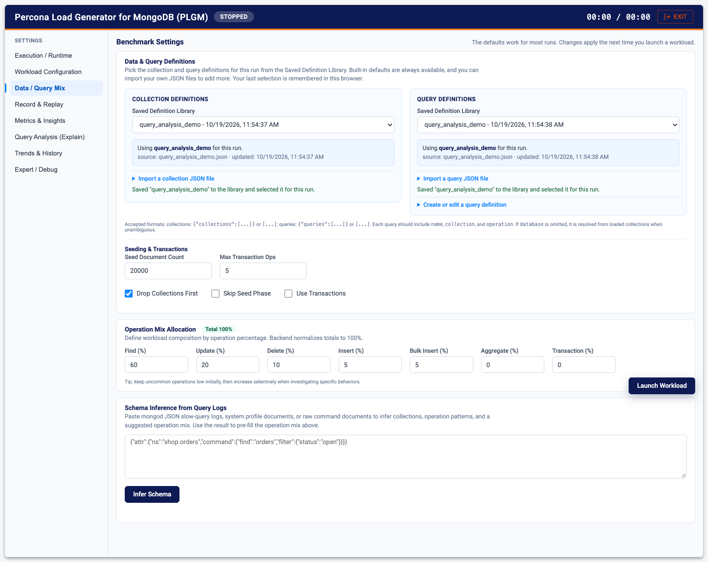

# Workloads: Collections, Queries, Seeding, and Operation Mix

A benchmark is only as useful as the workload behind it. PLGM ships a built-in workload so you can start in minutes, but the real value comes from running your own schema and your own queries. This guide covers both, plus seeding the initial data and setting the operation mix.

[Back to the main README](../README.md)

- [Default Workload](#default-workload)
- [Additional Workloads](#additional-workloads)
- [Choose a workload in the Web UI](#choose-a-workload-in-the-web-ui)
- [Custom Workloads](#custom-workloads)
- [Workload Loading from the CLI](#workload-loading-from-the-cli)
- [Supported Data Types](#supported-data-types)
- [Field Constraints](#field-constraints-schema-aware-bounded-values)
- [Indexes and Shard Keys](#indexes-and-shard-keys)
- [Query Accuracy](#query-accuracy-targeting-existing-records)
- [Seeding the Initial Data](#seeding-the-initial-data)
- [Operation Mix and Transactions](#operation-mix-and-transactions)
- [Sharding Strategy](#sharding-strategy)
- [Sort Key Order and Upgrading Saved Definitions](#sort-key-order-and-upgrading-saved-definitions)
- [Where Definitions Are Stored](#where-definitions-are-stored)

---

## Default Workload

Whether you run PLGM from the CLI or the UI, it comes with a built-in default workload (a flights data set) for immediate testing.

```bash
# Edit config.yaml to set your URI, then run:
./bin/plgm
```

PLGM comes pre-configured with a [default collection](../resources/collections/default.json) and [default queries](../resources/queries/default.json). If you do not provide any parameters and leave `default_workload: true`, this default workload is used. In the Web UI, the built-in defaults are pre-selected in the **Saved Definition Library**, so a run is always ready without extra steps.

If you wish to use a different default workload, replace these two files with your own `default.json` files in the same paths.

If you do not specify a config file name, PLGM uses [config.yaml](../config.yaml). You can keep separate configuration files and pass one as an argument:

```bash
./bin/plgm /path/to/some/custom_config.yaml
```

## Additional Workloads

The repo includes additional workloads you can use as references to benchmark your environment when you prefer not to write your own definitions. If your goal is to test your application accurately, create collection definitions and queries that match those your application uses.

* [collections](../resources/collections/)
* [queries](../resources/queries/)

The `query_analysis_demo` workload is built to show the [query and index analysis](./query-analysis.md#try-it-with-the-demo-workload).

## Choose a workload in the Web UI

The Web UI saves reusable query and collection definition files so you do not need to upload them every time you start a workload.

1. Start the UI with `./plgm --webui` and open the **Data / Query Mix** tab.
2. The **Data & Query Definitions** section has two cards, **Collection Definitions** and **Query Definitions**. Each has a **Saved Definition Library** dropdown, which is the main way to choose what runs.
3. To add your own file: open **Import a collection JSON file** (or **Import a query JSON file**), choose the file, and click **Save to Library**. PLGM validates it, stores it, and selects it for the run.
4. To edit queries in the browser: open **Create or edit a query definition**. Change the JSON in the **Query JSON Editor**, set a **Query Definition Name** and **Description**, then click **Save to Library** to update the selected definition or **Save As New** to create a copy. **New** starts an empty definition; **Delete** removes one. Built-in defaults are read-only, so editing one and saving creates a new custom definition.
5. To use a file once without saving it: choose it in the import section and launch without clicking **Save to Library**. An unsaved imported file is used for that run only and overrides the library selection.
6. A short summary under each card shows which definition is selected for the run.

The same tab also holds [seeding and transactions](#seeding-the-initial-data), the [operation mix](#operation-mix-and-transactions), and [schema inference](./load-modeling.md#schema-inference-from-query-logs). Here the `query_analysis_demo` files have been saved to the library and selected:



Uploaded and edited definitions are validated before they are saved. PLGM rejects empty files, malformed JSON, invalid workload schemas, duplicate namespaces in collection definitions, duplicate query names in a query definition, duplicate saved definition names, and duplicate saved content.

Prefer to start from your production logs? Use [Schema Inference from Query Logs](./load-modeling.md#schema-inference-from-query-logs) on the same tab.

## Custom Workloads

To run your own workload against your own schema:

1.  **Define Collection Schema:**
    Create a JSON file (e.g., `my_collection.json`) defining your schema.

    ```json
    [
      {
        "database": "ecommerce",
        "collection": "orders",
        "fields": {
          "_id": { "type": "objectid" },
          "customer_name": { "type": "string", "provider": "first_name" },
          "total": { "type": "double" },
          "created_at": { "type": "date" }
        }
      }
    ]
    ```

2.  **Define Query Patterns:**
    Create a JSON file (e.g., `my_queries.json`) defining the operations to run.

    ```json
    [
      {
        "database": "ecommerce",
        "collection": "orders",
        "operation": "find",
        "filter": { "customer_name": "<string>" },
        "limit": 10
      },
      {
        "database": "ecommerce",
        "collection": "orders",
        "operation": "updateOne",
        "filter": { "order_uuid": "<string>" },
        "update": { "$set": { "status": "processed" } },
        "upsert": true
      }
    ]
    ```

3.  **Run:** in the Web UI, import both files on **Data / Query Mix** (see above). From the CLI:
    ```bash
    export PLGM_COLLECTIONS_PATH=./my_collection.json
    export PLGM_QUERIES_PATH=./my_queries.json
    ./bin/plgm
    ```

Any `updateOne` or `updateMany` operation can include `"upsert": true`, so MongoDB creates the document if no match is found for the filter.

## Workload Loading from the CLI

To run your own stress tests from the CLI, set `default_workload: false` in `config.yaml` and provide the files:

1.  **Create Directories**: Create folders for your definitions (e.g., `resources/collections` and `resources/queries`).
2.  **Add Files**: Place your JSON schema and query definitions inside these folders.
3.  **Update Config**: Ensure `collections_path` and `queries_path` in your `config.yaml` point to these directories, or use the `PLGM_COLLECTIONS_PATH` and `PLGM_QUERIES_PATH` environment variables.

> **Important:** In custom mode, the application expects these folders to exist. If they are missing, PLGM reverts to the embedded defaults to prevent a crash, but your custom test **will not run** until the files are in place.

PLGM supports two loading modes:

### 1. Single File Mode
If you point to a specific file, PLGM loads **only** that file, regardless of its name, and ignores the default workload setting.

```bash
# Loads only my_custom_workload.json
export PLGM_COLLECTIONS_PATH="./resources/collections/my_custom_workload.json"
```

### 2. Directory Mode (Multi-file)
If you point to a folder, PLGM scans and merges **all** `.json` files found in that folder. This lets you split complex schemas across multiple files. The default workload is ignored.

```bash
# Loads all .json files in the /custom folder
export PLGM_COLLECTIONS_PATH="./resources/custom_collections/"
```

### Single-File Multi-Definition Format
When using a single file, PLGM supports both the legacy array format and the wrapped multi-definition format:

- Collections:
  - `[{...}]`
  - `{"collections":[...]}`
- Queries:
  - `[{...}]`
  - `{"queries":[...]}`

For multi-collection workloads, each query must identify its target collection (and database when needed). PLGM validates query-to-collection mapping before execution and fails early on unknown or ambiguous references.
Using the same collection name in different databases is supported (for example `db1.orders` and `db2.orders`).

Example files:

- [`resources/collections/multi_collections.json`](../resources/collections/multi_collections.json)
- [`resources/queries/multi_queries.json`](../resources/queries/multi_queries.json)

### Default Workload Filtering
When using **Directory Mode**, the behavior depends on the `PLGM_DEFAULT_WORKLOAD` setting:

* **`true` (Default):** Loads **only** `default.json` (if present). It ignores all other files in the folder.
* **`false` (Custom):** Loads all JSON files **except** `default.json`.
  * *Use Case:* Set this to `false` to run your custom workload files while keeping `default.json` in the folder for reference (it will be ignored).

## Supported Data Types
* **Primitives:** `int`, `long`, `double`, `decimal128`, `bool`, `string`.
* **Time:** `date`, `timestamp`.
* **Binary/Logic:** `binary`, `uuid`, `objectid`, `regex`, `javascript`.
* **Complex:** `object`, `array`.
* **Providers:** Supports ANY gofakeit provider via reflection. Example: `beer_name`, `car_maker`, `bitcoin_address`, `credit_card`, `city`, `ssn`, etc.
* **Domain providers (airline workload):** `flight_code` (e.g. `DL482`), `gate` (e.g. `B7`), `airport_code` / `airport` (IATA), `airline`, `aircraft` / `plane_type`, `seats_available`, `duration_minutes`, `equip` (aircraft object), `passengers` (passenger list).

## Field Constraints (schema-aware bounded values)
Each field may declare optional constraints so generated data stays realistic and bounded:

| Key         | Applies to        | Description |
|-------------|-------------------|-------------|
| `min`/`max` | `int`, `double`   | Inclusive numeric range. Unbounded ints default to a large range, so set these for real-world fields. |
| `enum`      | any type          | Picks a random value from the provided list (strings or numbers). Takes precedence over `provider`/`type`. |
| `template`  | `string`          | Pattern expander: `#` → digit, `?` → uppercase letter, `^` → lowercase letter (e.g. `"??###"` → `DL482`). |
| `minLength`/`maxLength` | `string`, provider args | Length hints passed to length-aware providers. |
| `arraySize` | `array`           | Fixed element count (otherwise randomized). |
| `items`     | `array`           | Field definition for array elements. |
| `fields`    | `object`          | Nested field definitions. |

```json
{
  "duration_minutes": { "type": "int", "min": 30, "max": 900 },
  "status":           { "type": "string", "enum": ["scheduled", "boarding", "landed", "cancelled"] },
  "flight_code":      { "type": "string", "template": "??###" }
}
```

## Indexes and Shard Keys
Collection definitions may declare `indexes` and a `shardConfig`. Keys are applied in the order you write them, with the direction you write them; compound keys are never reordered or alphabetized.

```json
"indexes": [
  { "keys": { "origin": 1, "destination": 1, "flight_date": -1 } },
  { "keys": [ { "status": 1 }, { "created_at": -1 } ], "name": "by_status", "unique": true },
  { "keys": { "created_at": 1 }, "expireAfterSeconds": 86400 },
  { "keys": { "sku": 1 }, "partialFilterExpression": { "qty": { "$gt": 5 } } }
],
"shardConfig": { "key": { "region": 1, "order_id": 1 } }
```

* `keys` is either an object (fields in written order) or an array of single-field objects. Use the array form if a tool that edits your JSON may reorder object keys.
* Key values: `1`, `-1`, `"hashed"`, `"text"`, `"2dsphere"`, `"2d"`. Shard key values: `1` or `"hashed"` (at most one hashed field).
* Supported options: `name`, `unique`, `sparse`, `hidden`, `expireAfterSeconds`, `partialFilterExpression` (Extended JSON allowed). Any other option (for example `collation`) is rejected at load time with an explicit error instead of being silently ignored.
* Loading fails for a field declared twice in one key, two indexes in one collection with the same key pattern, or two indexes that resolve to the same name. The same fields in a different order are distinct indexes and are allowed.
* Without `name`, the index name is generated from the keys in order (`origin_1_destination_1_flight_date_-1`), so repeated runs send identical definitions and MongoDB leaves existing indexes alone. If an existing index has the same name or keys with different options, setup fails with the server's conflict error; it is not suppressed or replaced.

**Upgrading from earlier versions:** earlier releases decoded keys into an unordered map, so compound indexes could be created with a different field order on each run (for example both `origin_1_destination_1_flight_date_-1` and `destination_1_flight_date_-1_origin_1`), and shard keys were alphabetized. PLGM never drops indexes. During setup it logs a warning for each deployed index that has the same fields and directions as a configured index in a different order. To review them yourself, run `db.<collection>.getIndexes()` and compare against your definition; check `$indexStats` usage before dropping any with `db.<collection>.dropIndex("<name>")`. Existing configuration files need no changes unless they used options or key values listed above as unsupported.

## Query Accuracy (targeting existing records)
Find/update/delete query filters use placeholders such as `<int>` and `<string>`. At runtime PLGM
maintains an in-memory **record pool** of inserted (and bootstrap-sampled) documents and, for
`existing_record_hit_rate`% of operations, fills those placeholders with real values from the pool.
This ensures operations actually read/update/delete documents that exist instead of missing on random
values, so benchmark results reflect real work rather than empty matches. Tune via
`existing_record_hit_rate`, `record_pool_max_size`, and `record_pool_bootstrap_sample` in `config.yaml`.

### Workload Accuracy Metrics
The final summary includes a **WORKLOAD ACCURACY** section reporting existing-record targeting,
find match/miss rate, documents returned, update matched/modified counts, and delete hit rate, so a
fast-but-misleading run (mostly missing records) is easy to spot.

## Seeding the Initial Data

Before the workload starts, PLGM can drop the collections, create indexes, and insert a starting data set.

**In the Web UI:**

1. **Data / Query Mix > Seeding & Transactions**:
   - **Seed Document Count**: documents to insert per collection.
   - **Drop Collections First**: drop and recreate the collections before seeding.
   - **Skip Seed Phase**: on to run against data that is already there (for example a restored snapshot).
2. **Execution / Runtime > Execution / Runtime Tuning**:
   - **Seed Batch Size**: documents per `InsertMany` call (1000 is a good default).
   - **Seed Concurrency**: parallel insert writers during seeding (see below).
3. Optional, for identical data on every run or every server: **Record & Replay > Seed & Determinism > Random Seed** (see [Deterministic Generation](#deterministic-generation)).

| Config Setting | Environment Variable | Description | Example |
| :--- | :--- | :--- | :--- |
| `documents_count` | `PLGM_DOCUMENTS_COUNT` | Number of documents to seed initially | `10000` |
| `drop_collections` | `PLGM_DROP_COLLECTIONS` | Drop collections before starting | `true` |
| `skip_seed` | `PLGM_SKIP_SEED` | Do not seed initial data on start | `true` |
| `seed_batch_size` | `PLGM_SEED_BATCH_SIZE` | Documents per batch during the SEED phase | `1000` |
| `seed_concurrency` | `PLGM_SEED_CONCURRENCY` | Concurrent seed writers, independent of workload concurrency | `1` |

### Parallel Initial Seeding
Set `seed_concurrency` (or `PLGM_SEED_CONCURRENCY`, UI: **Seed Concurrency**) to run multiple `InsertMany`
calls concurrently during initialization. It defaults to `1`; omitted or non-positive
YAML values fall back to `1`. Like `PLGM_SEED_BATCH_SIZE`, the environment override
accepts only positive integers. Workload `concurrency` does not control seeding.

```yaml
skip_seed: false
documents_count: 1000000  # Per collection, not per writer
seed_batch_size: 1000
seed_concurrency: 8
```

Collections are still seeded sequentially. Within each collection, one producer
generates documents and up to `seed_concurrency` writers insert separate batches.
The writer count is capped at the number of batches. Memory for generated documents
is bounded by at most `(writers + 1) * seed_batch_size` documents, plus driver buffers.
Size the MongoDB connection pool for the desired concurrency; document generation,
indexes, server resources, and available connections can limit the speedup.

Batch completion order is unspecified when using multiple writers; writes within
each batch retain the driver's default ordered behavior. Progress counts only fully
successful batches. On an insert error or cancellation, seeding stops dispatching
new batches, cancels in-flight writes, and waits for all writers before returning.
Already accepted writes (including a partially successful batch) are not rolled back.

### Deterministic Generation
Set `random_seed` (or `PLGM_RANDOM_SEED`, UI: **Record & Replay > Seed & Determinism > Random Seed**) to a non-zero value to seed random generation.
The same seed, `documents_count`, and collection definitions seed identical documents on
any instance: generated ObjectIds come from the seeded random stream, generated dates use a
fixed reference time (2025-01-01 UTC) instead of the clock, and with `drop_collections` on
each seeded document gets a seeded `_id`. Seed document generation remains serial, so
writer scheduling does not change the sequence; parallel insertion does not preserve
insertion order. Concurrent workload streams are seeded per-worker from the base, but
ordinary generated traffic still depends on timing (which records the shared pool holds,
how many operations fit in `duration`); use
[Deterministic Generated Traffic](./record-and-replay.md#deterministic-generated-traffic) or
[Record and Replay](./record-and-replay.md) when the operations themselves must match.
With deterministic traffic, Duration is still how long the run lasts. Operations per Worker
is one pass, and the same workload continues until Duration ends. That page explains how
to read the clock, the operation counts, and the fingerprint.
Leave `0` for time-based, non-deterministic generation.

## Operation Mix and Transactions

**In the Web UI:**

1. **Data / Query Mix > Operation Mix Allocation**: set **Find (%)**, **Update (%)**, **Delete (%)**, **Insert (%)**, **Bulk Insert (%)**, **Aggregate (%)**, and **Transaction (%)**. The live total must reach 100%.
2. For transactions: **Data / Query Mix > Seeding & Transactions**: turn on **Use Transactions** and set **Max Transaction Ops**.
3. During the run, the **Workload Anatomy** chart on the dashboard confirms the database is executing the mix you asked for.

By default, the tool comes preconfigured with the following workload distribution:

| Operation | Percentage |
| :--- | :--- |
| Find  | 50% |
| Update  | 20% |
| Delete  | 10% |
| Insert  | 5% |
| Bulk Inserts | 5% |
| Aggregate | 5% |
| Transaction | 5% |

Please note:

* If `use_transactions: false`, the `transaction_percent` value is ignored.
* Aggregate operations only generate activity if at least one query with `"operation": "aggregate"` is defined in your active query files; otherwise `aggregate_percent` is ignored.
* The maximum number of operations within a transaction is defined by `max_transaction_ops` or `PLGM_MAX_TRANSACTION_OPS`. The number of operations per transaction is randomized, up to that maximum.
* Multi-Collection Load: if multiple collections are defined, each worker randomly selects a collection for every operation. This includes operations within a transaction, allowing for cross-collection atomic updates.

| Config Setting | Environment Variable | Description | Example |
| :--- | :--- | :--- | :--- |
| `find_percent` | `PLGM_FIND_PERCENT` | Percentage of Find operations | `60` |
| `insert_percent` | `PLGM_INSERT_PERCENT` | Percentage of Insert operations (not related to the initial seed inserts) | `5` |
| `bulk_insert_percent` | `PLGM_BULK_INSERT_PERCENT` | Percentage of Bulk Insert operations (not related to the initial seed inserts) | `5` |
| `update_percent` | `PLGM_UPDATE_PERCENT` | Percentage of Update operations | `20` |
| `delete_percent` | `PLGM_DELETE_PERCENT` | Percentage of Delete operations | `10` |
| `aggregate_percent` | `PLGM_AGGREGATE_PERCENT` | Percentage of Aggregate operations | `0` |
| `transaction_percent` | `PLGM_TRANSACTION_PERCENT` | Percentage of Transactional operations | `0` |
| `use_transactions` | `PLGM_USE_TRANSACTIONS` | Enable transactional workloads | `false` |
| `max_transaction_ops` | `PLGM_MAX_TRANSACTION_OPS` | Maximum operations grouped into a single transaction | `5` |

## Sharding Strategy

**In the Web UI:** open **Workload Configuration > Sharding Strategy**.

- **Sharding Mode**: **Auto Detect** (recommended) decides per collection; **Force On** and **Force Off** override it.
- **Skip Generic Setup When shardConfig Is Missing**: recommended for mixed sharded and non-sharded workloads, so only collections with a `shardConfig` are sharded.

| Config Setting | Environment Variable | Description | Example |
| :--- | :--- | :--- | :--- |
| `sharding_mode` | `PLGM_SHARDING_MODE` | Per-collection sharding behavior: `auto`, `force_on`, `force_off` | `auto` |
| `sharding_skip_generic_without_config` | `PLGM_SHARDING_SKIP_GENERIC_WITHOUT_CONFIG` | Skip generic sharding setup for collections without `shardConfig` | `true` |

## Sort Key Order and Upgrading Saved Definitions

**Sort key order:** sort specifications keep the key order you write, from loading through execution, the library, capture, and explain. This applies to `$sort` stages (including inside `$facet`, `$lookup`, and `$unionWith` pipelines), the `sortBy` argument of `$setWindowFields`, `$fill`, `$top`, `$bottom`, `$topN`, `$bottomN`, and `$sortArray`, and the `$sort` modifier of `$push` in update documents. `{"$sort": {"b": -1, "a": 1}}` sorts by `b` first. Values must be `1`, `-1`, or `{"$meta": "textScore"}`/`{"$meta": "searchScore"}`; the `$push` modifier and `$sortArray` also accept a bare `1` or `-1`. A sort with a repeated key, no keys, a `$`-prefixed key, or another value is rejected.

**Upgrading from earlier versions:** earlier releases ran multi-key sorts in an undefined key order and saved library definitions with their keys sorted alphabetically. PLGM cannot recover the original precedence, so a saved query definition from an earlier release that contains a multi-key sort needs review before it can run:

1. Select it in the library. Its dropdown entry says *sort order review needed*, and a warning lists each multi-key sort by path (for example `queries[0].pipeline[2].$facet.top[0].$sort`) with its current field order.
2. Open the editor and put each listed sort's fields in the intended order. The current order may be alphabetical rather than what you originally wrote.
3. Tick the confirmation for every listed sort, then click **Save Reviewed Definition** (or **Save to Library**).

Until then, **Launch Workload** is blocked, and `/api/start` refuses the definition with HTTP 409 and `code: "sort_order_review_required"`. Saving without confirming every sort is also refused with a 409, and nothing is stored. Re-saving alone never counts as confirmation. A confirmation covers one exact order: if you confirm a sort and then change its fields or directions, the save is refused with a fresh, unticked checklist showing the new order, so confirm again. The reviewed definition is saved in declared order (`contentVersion` 2) and runs normally.

**Save As New** from a definition that needs review needs the same confirmations, and the backend enforces them. The copy records which definition and version it came from; if that definition was changed or deleted in the meantime, the save is refused with a 409 and you reload and copy again. Copying does not resolve the original.

API clients confirm by sending `reviewedSorts`, a list of `{"path", "sortSpec"}` taken from the `sortOrderReview.issues` returned for the content being saved (`sortSpec` is the ordered sort as compact JSON, for example `{"b":-1,"a":1}`), in the `PUT` body. A `POST` that copies a library definition also sends `sourceDefinitionId`, `sourceUpdatedAt`, and `sourceContentVersion` (the `id`, `updatedAt`, and `contentVersion` of the definition it was copied from). The older path-only `reviewedSortPaths` field is rejected with a 400.

PLGM can only enforce review where it knows the content came from an earlier release: a saved definition, or a copy that names its source. It cannot tell where pasted JSON, a `POST` without a source, an uploaded file, or a one-off query file came from. That content is treated as new and runs in the order written. If you copy an old definition's JSON by hand, check its multi-key sorts yourself. Definitions with only single-key sorts and definitions saved by this version need no changes.

## Where Definitions Are Stored

Definition storage is durable application storage, separate from browser caching. By default PLGM stores definitions in a local JSON file under the user config directory:

```bash
~/.config/plgm/definitions.json                         # Linux
~/Library/Application Support/plgm/definitions.json     # macOS
```

You can override the location with:

```bash
export PLGM_DEFINITIONS_STORE=/path/to/plgm-definitions.json
```

Run history for Trends is stored next to it, in `trend_baselines.json`. See [Trends and History](./trends-and-history.md#where-history-is-stored).

The last selected query and collection definitions are cached in browser `localStorage` so the Web UI can restore your previous selections after refresh. This cache only stores selected IDs; the actual definition content is stored server-side in the JSON store.

Storage decision: PLGM uses local file-based JSON storage because it has no existing database dependency, usually runs as a single local or single-container Web UI process, and needs simple durable persistence with easy backup and restore. SQLite would be a reasonable future option if richer querying, heavier concurrent editing, or multi-user metadata becomes necessary. Valkey/Redis is not used because PLGM does not require distributed cache/state for this feature and adding it would increase operational complexity without improving the single-instance workflow.
